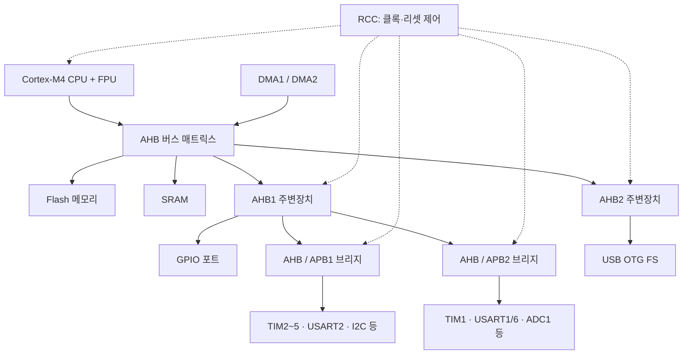

# STM32 Embedded Study

STM32 마이크로컨트롤러의 구조와 동작 원리를 이해하고, 하드웨어 제어 및 임베디드 소프트웨어 개발 역량을 기르기 위한 개인 학습 저장소입니다.

『STM32CubeIDE를 이용한 Cortex-M4 기초 및 응용』을 기반으로 **이론 학습 → 회로 분석 → 코드 구현 → 실습 및 디버깅** 순서로 학습하며, 배운 내용을 직접 정리합니다.

## 1. 학습 목표

- ARM Cortex-M4 및 STM32 MCU 아키텍처 이해
- 전압, 전류, 저항 등 전자회로 기초 학습
- STM32 GPIO 및 주요 주변장치의 동작 원리 이해
- STM32CubeIDE, CubeMX, HAL을 활용한 펌웨어 개발
- 레지스터와 HAL API의 관계 이해
- 실제 하드웨어 실습을 통한 문제 해결 능력 향상

## 2. 개발 환경

| 구분 | 내용 |
| --- | --- |
| 개발 보드 | STM32 NUCLEO-F411RE |
| MCU | STM32F411RET6 |
| CPU Core | ARM Cortex-M4 |
| IDE | STM32CubeIDE |
| 설정 도구 | STM32CubeMX |
| 펌웨어 라이브러리 | STM32F4 HAL / CMSIS |
| 언어 | C |
| 디버거 | ST-LINK |

### 참고 교재

**『STM32CubeIDE를 이용한 Cortex-M4 기초 및 응용』 — 박민상**

교재의 학습 흐름을 따라가되, 추가로 조사한 내용과 실습 과정에서 이해한 개념을 직접 정리합니다.

## 3. 학습 진행 현황

### 교재 진도

| 구분 | 진행 상태 |
| --- | --- |
| Chapter 01 — 실습보드 이해 | 진행 중 |
| Chapter 02 ~ 10 | 예정 |

### 주요 학습 내용

| 학습 주제 | 진행 상태 |
| --- | --- |
| STM32 MCU / Cortex-M4 구조 | 학습 완료 |
| ST-LINK 및 개발보드 구조 | 학습 완료 |
| HSI / HSE / PLL 클록 | 학습 완료 |
| 전압·전류·저항 기초 | 학습 완료 |
| GPIO — RCC / MODER | 학습 완료 |
| GPIO — ODR / BSRR | 학습 완료 |
| GPIO — Push-Pull / Open-Drain | 학습 중 |
| GPIO — Pull-up / Pull-down / OTYPER | 학습 중 |
| LED 점멸 실습 | 실습 완료 |
| 버튼과 외부 인터럽트 | 입력·EXTI 개념 정리 및 레지스터 실습 코드 작성 |
| UART 통신 | 프레임·보드레이트 정리 및 인터럽트 에코 코드 작성 |
| ADC | 변환 원리·ADC1 설정 정리 |
| Timer / DMA | 실습 예정 |

개념 학습과 보드 검증 결과를 실습 기록에 따로 표시합니다. 이전 LD2 점멸은 보드에서 정상 동작을 확인했습니다.

## 4. 저장소 구조

```text
STM32-Embedded-Study/
├── .gitignore
├── README.md
├── docs/                  # 개념 및 이론 정리
│   ├── clock/
│   ├── gpio/
│   └── uart/
├── examples/              # STM32CubeIDE 실습 프로젝트
│   ├── gpio-led/          # 내장 LD2 및 외부 LED 실습
│   ├── F411_EXTI_Practice/ # 스위치와 LED의 레지스터 기반 EXTI 실습
│   └── USART_TEST/         # USART2 인터럽트 에코 실습
├── troubleshooting/       # 오류 분석 및 해결 기록
└── assets/                # 회로도, 실습 사진 및 이미지
```

새 실습 프로젝트와 학습 기록은 진행하면서 순차적으로 추가합니다. 저장소를 내려받은 로컬 폴더 이름은 달라도 됩니다.

- [LED 실습과 빌드 방법](examples/gpio-led/README.md)
- [외부 스위치 EXTI 실습](docs/gpio/LED_switch_interrupt.md)
- [USART2 인터럽트 에코 실습](docs/uart/uart.md#4-usart_test-실습)
- [주제별 학습 문서](docs/README.md)
- [오류 기록 안내](troubleshooting/README.md)
- [이미지 관리 안내](assets/README.md)

### STM32CubeIDE에서 열기

1. **File → Import → General → Existing Projects into Workspace**를 선택합니다.
2. 실습별로 `.project`가 있는 경로를 지정합니다. LED는 `examples/gpio-led`, EXTI는 `examples/F411_EXTI_Practice/STM32CubeIDE`, UART는 `examples/USART_TEST`입니다.
3. 원하는 실습을 선택하고 **Copy projects into workspace**를 해제한 뒤 가져옵니다.
4. **Project → Build Project**로 빌드합니다.

기존 위치의 `test_led`가 이미 등록되어 있다면 Project Explorer에서 기존 프로젝트를 제거한 뒤 다시 가져옵니다. 이때 **Delete project contents on disk**는 선택하지 않습니다. 프로젝트 내부 이름은 계속 `test_led`를 사용합니다.

## 5. 학습 및 기록 방식

각 학습 주제는 다음 내용을 중심으로 정리합니다.

1. 용어와 동작 원리를 정리합니다.
2. 회로도와 전기적 특성을 확인합니다.
3. 레지스터의 설정과 동작을 읽습니다.
4. HAL 함수와 실제 레지스터 접근을 연결합니다.
5. 실습 코드와 빌드·보드 확인 결과를 기록합니다.
6. 문제가 생기면 원인과 해결 방법을 기록합니다.

단순히 코드를 동작시키는 것에 그치지 않고, **왜 해당 설정과 코드가 필요한지 이해하는 것**을 목표로 합니다.

## 6. 주요 참고 자료

### 가장 먼저 보는 문서

**레지스터 설정과 주변장치 동작을 공부할 때는 RM0383을 기준으로 확인합니다.** 핀 배치와 전기적 조건은 데이터시트, 실제 보드의 배선과 점퍼는 보드 매뉴얼을 함께 봅니다.

| 우선순위 | 자료 | 찾아볼 내용 |
| --- | --- | --- |
| 1 | **[RM0383 — STM32F411 Reference Manual (PDF)](https://www.st.com/resource/en/reference_manual/dm00119316.pdf)** | 메모리 맵, RCC·클록 트리, GPIO, EXTI, 타이머, 통신 주변장치의 동작과 레지스터 비트 |
| 2 | [DS10314 — STM32F411 데이터시트 (PDF)](https://www.st.com/resource/en/datasheet/stm32f411re.pdf) | MCU 내부 블록도, 패키지별 핀 배치·대체 기능, 전압·전류·타이밍 조건 |
| 3 | [UM1724 — Nucleo-64 보드 매뉴얼 (PDF)](https://www.st.com/resource/en/user_manual/dm00105823-stm32-nucleo64-boards-mb1136-stmicroelectronics.pdf) | 보드 구성, 전원, ST-LINK, 점퍼 및 커넥터. [F411RE 핀맵 바로가기](https://www.st.com/resource/en/user_manual/dm00105823-stm32-nucleo64-boards-mb1136-stmicroelectronics.pdf#page=33) |
| 4 | [보드 회로도 — 공식 CAD Resources](https://www.st.com/en/evaluation-tools/nucleo-f411re.html#cad-resources) | LED·버튼·전원·커넥터의 실제 연결. 보드에 인쇄된 MB1136 리비전과 맞는 회로도 선택 |

핀맵 바로가기는 UM1724 Rev 17의 p.33, Figure 18 기준입니다. 문서 개정 시 `NUCLEO-F411RE`를 검색합니다.

### MCU 내부 구조 한눈에 보기

아래는 **학습용으로 단순화한 연결도**입니다. 전체 구조와 세부 연결은 [공식 데이터시트 p.16, Figure 3 — STM32F411xC/xE block diagram](https://www.st.com/resource/en/datasheet/stm32f411re.pdf#page=16)을 확인합니다.



GPIO 학습에서는 **RCC로 포트 클록 활성화 → GPIO 레지스터 설정 → 핀 입력·출력 제어**를 연결해서 봅니다. 실제 사용할 수 있는 핀과 주변장치 기능은 STM32F411RE의 패키지와 보드 배선을 확인합니다.

### HAL 코드와 대조하기

- [CMSIS 디바이스 헤더](examples/gpio-led/Drivers/CMSIS/Device/ST/STM32F4xx/Include/stm32f411xe.h): 메모리 주소, 레지스터 구조체, 비트 정의
- [HAL GPIO 구현](examples/gpio-led/Drivers/STM32F4xx_HAL_Driver/Src/stm32f4xx_hal_gpio.c): HAL 함수가 실제로 접근하는 레지스터

## 7. 학습 원칙

- 교재의 실습 흐름을 기본으로 학습합니다.
- 이론은 이해한 내용을 바탕으로 직접 재구성하여 기록합니다.
- HAL 코드와 관련 레지스터의 동작을 함께 확인합니다.
- 실습 중 발생한 오류는 원인과 해결 과정을 기록합니다.
- 실습 코드와 하드웨어 동작 결과를 함께 관리합니다.

---

STM32의 내부 동작과 하드웨어 구조를 이해하고, 스스로 임베디드 시스템을 설계·구현·디버깅하는 것을 최종 목표로 합니다.
