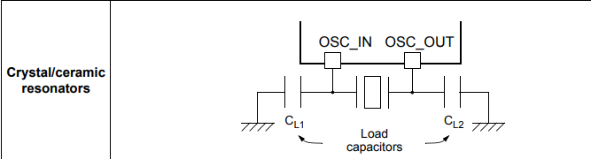
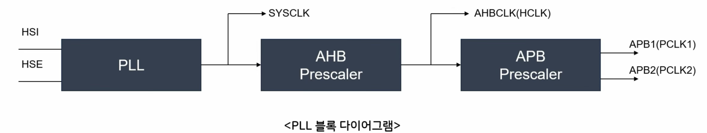
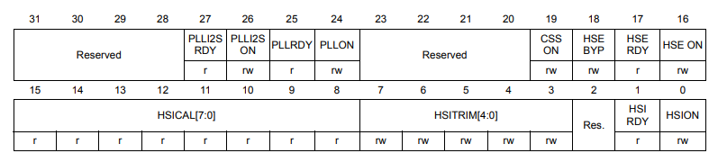
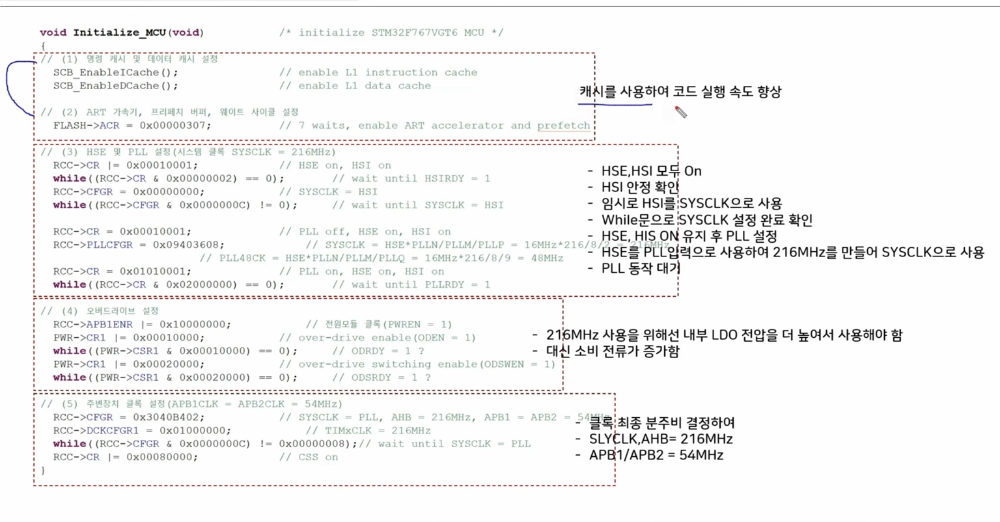

# STM32 클록과 RCC·PLL 학습 정리

2026.11.18 · NUCLEO-F411RE / 강의의 STM32F767 예제 비교

## 1. 클록이란?

MCU 내부의 CPU와 여러 주변장치는 클록을 기준으로 동작한다. 클록 주파수가 높으면 같은 시간에 더 많은 클록 사이클이 발생한다. 다만 명령어마다 필요한 사이클 수와 메모리 대기 시간이 다르므로, 클록 수와 명령어 처리 수가 항상 같지는 않다.

**현재 보드는 STM32F411RE(Cortex-M4, 최대 100MHz)**다. 작성한 강의 예제는 **STM32F767(Cortex-M7, 최대 216MHz)**를 대상으로 하므로 설정값과 코드를 구분한다.

| 구분 | 현재 프로젝트 | 강의 예제 |
| --- | --- | --- |
| MCU | STM32F411RE | STM32F767VGT6 |
| 코어 | Cortex-M4 | Cortex-M7 |
| 최대 CPU 클록 | 100MHz | 216MHz |
| 이 문서의 계산 예 | HSI → PLL → 84MHz | HSE 16MHz 가정 → PLL → 216MHz |
| 주의 | F411 설정과 제한 확인 | F7 캐시·Over-drive 코드를 F411에 복사하지 않기 |

### 분주와 프리스케일러

프리스케일러는 입력 클록을 정해진 비율로 나눈다.

```text
입력 100MHz → 프리스케일러 /2 → 출력 50MHz
```

CPU와 버스, 주변장치는 허용하는 최대 주파수와 필요한 속도가 다르다. 분주로 동작 주파수를 맞추고 소비 전력이나 타이머의 시간 간격을 조정한다. 버스 프리스케일러와 타이머 내부의 PSC는 별도 설정이다.

## 2. 클록 소스

| 소스 | 의미 | 대표 주파수 / 용도 |
| --- | --- | --- |
| HSI | High Speed Internal | 내부 RC 16MHz, SYSCLK 또는 PLL 입력 |
| HSE | High Speed External | 외부 크리스탈·세라믹 공진자 또는 외부 클록 입력 |
| LSI | Low Speed Internal | 내부 RC 약 32kHz, IWDG·RTC 등 |
| LSE | Low Speed External | 외부 32.768kHz 크리스탈, 주로 RTC |

### HSE: 외부 고속 클록

크리스탈·세라믹 공진자를 OSC_IN/OSC_OUT에 연결하는 방식과, 외부에서 만든 클록을 OSC_IN으로 공급하는 Bypass 방식이 있다. F411의 크리스탈·공진자 입력 범위는 4~26MHz이며 Bypass 입력 조건은 별도로 확인한다.

크리스탈 회로의 부하 커패시터는 소자의 사양과 회로 조건에 맞게 선정한다. **HSE가 언제나 16MHz인 것은 아니다.** 아래 F767 계산의 16MHz는 강의 예제의 입력값이다.



### HSI: 내부 고속 클록

외부 소자 없이 내부 RC 오실레이터로 16MHz를 만든다. 외부 부품을 줄일 수 있지만 정밀도는 온도·전압 등의 영향을 받으므로 요구 정확도와 데이터시트 조건을 확인한다.

리셋 직후에는 HSI가 SYSCLK으로 선택된다. HSE 장애 시 CSS가 활성화된 경우의 복구 동작과 Stop 모드 복귀 시 동작은 매뉴얼에서 확인한다. **HSI가 Stop·Standby 중 계속 동작한다는 의미는 아니다.**

### LSE와 LSI: 저속 클록

LSE는 정확한 시간 기준이 필요한 RTC에 많이 사용한다. LSI는 내부 저속 RC 클록으로 IWDG나 RTC의 소스로 사용할 수 있다. 저전력 모드에서 어떤 클록이 유지되는지는 소스와 주변장치별로 확인한다.

## 3. PLL로 원하는 주파수 만들기

PLL(Phase-Locked Loop)은 HSI 또는 HSE를 입력으로 받아 분주·체배하여 필요한 클록을 만든다. PLL 출력 범위와 설정 제한은 MCU마다 다르다.



```text
PLL 입력      = HSI 또는 HSE
VCO 입력      = PLL 입력 / PLLM
VCO 출력      = VCO 입력 × PLLN
PLL 시스템 출력 = VCO 출력 / PLLP
PLLQ 출력     = VCO 출력 / PLLQ
```

### 강의의 F767 계산 예

HSE=16MHz, M=8, N=216, P=2, Q=9를 가정한다.

```text
VCO 입력 = 16 / 8       = 2MHz
VCO 출력 = 2 × 216      = 432MHz
PLLCLK   = 432 / 2      = 216MHz
PLLQ 출력 = 432 / 9     = 48MHz
```

이 값이 허용되는지는 해당 MCU의 VCO 범위, 전원 조건, Flash 대기 시간 등을 함께 확인해야 한다. 216MHz 설정은 현재 F411 보드의 설정이 아니다.

### PLL 설정 순서

1. 현재 SYSCLK이 PLL이라면 먼저 HSI 등 동작 가능한 다른 소스로 전환하고 전환 결과를 확인한다.
2. PLLON을 0으로 만들고 PLLRDY가 0이 될 때까지 기다린다.
3. PLL이 꺼진 상태에서 PLLCFGR의 소스와 M/N/P/Q 등을 설정한다.
4. 선택한 입력 소스의 RDY를 확인한 뒤 PLLON을 1로 만든다.
5. PLLRDY가 1이 될 때까지 기다린다.
6. 전원·Flash·버스 분주 조건을 준비한 뒤 SYSCLK을 PLL로 전환하고 SWS를 확인한다.

## 4. RCC 레지스터 읽기

| 레지스터 | 확인할 내용 |
| --- | --- |
| RCC_CR | HSI/HSE/PLL의 ON 및 RDY, CSS 등 |
| RCC_PLLCFGR | PLL 입력 소스와 분주·체배 값 |
| RCC_CFGR | SYSCLK 선택(SW), 실제 선택 상태(SWS), AHB/APB 분주 |
| RCC의 주변장치 Enable 레지스터 | GPIO 등 개별 주변장치에 클록 공급 허용 |



### ON과 RDY는 다르다

ON은 소프트웨어가 켜도록 요청하는 비트이고, RDY는 하드웨어가 준비 상태를 알려주는 비트다. 켜기만 하고 바로 다음 클록으로 전환하지 말고 준비 상태를 확인해야 한다.

```c
// STM32F411 CMSIS 정의를 사용한 흐름 설명용 코드 조각
RCC->CR |= RCC_CR_HSION;
while ((RCC->CR & RCC_CR_HSIRDY) == 0U)
{
    // HSIRDY가 0인 동안 대기, 1이면 반복 종료
}
```

기존 메모의 `while (... != 0)`은 준비 비트가 1인 동안 기다리므로 HSI 시작 대기 조건과 반대다. 실제 제품 코드에서는 실패 시 무한 대기에 빠지지 않도록 타임아웃이나 오류 처리를 고려한다. 현재 HAL 초기화 코드는 오류 반환 시 `Error_Handler()`를 호출한다.

SYSCLK 선택은 **CR이 아니라 CFGR의 SW**로 요청하고, **SWS**로 실제 전환 여부를 확인한다. `PCC`는 `RCC`의 오타다.

## 5. SYSCLK → HCLK → PCLK



```text
HSI / HSE → PLL 또는 직접 선택 → SYSCLK
                                  │
                             AHB 프리스케일러
                                  ↓
                                HCLK
                        ┌─────────┴─────────┐
                   APB1 분주           APB2 분주
                        ↓                   ↓
                      PCLK1               PCLK2
```

- **SYSCLK:** 선택된 시스템 클록 소스의 출력
- **HCLK:** AHB 분주 후 CPU·AHB 등에 공급되는 클록
- **PCLK1/PCLK2:** APB 분주 후 해당 주변장치 버스에 공급되는 클록
- **SysTick:** CLKSOURCE 설정에 따라 HCLK 또는 HCLK/8을 사용하므로 실제 설정을 확인한다.

### 타이머 클록 주의점

TIMPRE=0의 기본 규칙에서는 APB 분주가 /1이면 TIMxCLK=PCLKx이고, /1이 아니면 TIMxCLK=2×PCLKx다.

하지만 **TIMPRE 설정에 따라 다른 규칙이 적용될 수 있다.** 강의 F767 예제는 DCKCFGR1의 TIMPRE를 설정하므로 PCLK=54MHz인데 TIMxCLK=216MHz인 경우를 단순한 두 배 규칙으로 설명하면 안 된다. 타이머 입력 클록과 타이머 내부 PSC 이후의 카운터 클록도 구분한다.

## 6. 현재 F411 프로젝트의 실제 설정

[main.c의 SystemClock_Config()](../../examples/gpio-led/Core/Src/main.c)에 있는 값은 다음과 같다.

```c
RCC_OscInitStruct.PLL.PLLSource = RCC_PLLSOURCE_HSI;
RCC_OscInitStruct.PLL.PLLM = 16;
RCC_OscInitStruct.PLL.PLLN = 336;
RCC_OscInitStruct.PLL.PLLP = RCC_PLLP_DIV4;
RCC_OscInitStruct.PLL.PLLQ = 4;

RCC_ClkInitStruct.SYSCLKSource = RCC_SYSCLKSOURCE_PLLCLK;
RCC_ClkInitStruct.AHBCLKDivider = RCC_SYSCLK_DIV1;
RCC_ClkInitStruct.APB1CLKDivider = RCC_HCLK_DIV2;
RCC_ClkInitStruct.APB2CLKDivider = RCC_HCLK_DIV1;
```

| 항목 | 계산 | 소스 설정으로 계산한 값 |
| --- | --- | --- |
| PLL 입력 | HSI | 16MHz |
| VCO 입력 | 16 / 16 | 1MHz |
| VCO 출력 | 1 × 336 | 336MHz |
| SYSCLK | 336 / 4 | 84MHz |
| HCLK | 84 / 1 | 84MHz |
| PCLK1 | 84 / 2 | 42MHz |
| PCLK2 | 84 / 1 | 84MHz |
| PLLQ 출력 | 336 / 4 | 84MHz |

PLLQ 출력은 이 설정에서 48MHz가 아니다. 48MHz를 요구하는 USB 등 기능을 추가할 때는 클록 구성을 다시 검토한다. 위 표는 소스 기반 계산이며 실제 보드에서 클록을 계측한 결과는 아니다.

## 7. 강의 F767 초기화 코드에서 배운 점

강의의 `Initialize_MCU()`는 다음 요소를 함께 다룬다. 하드코딩된 전체 초기화 함수를 F411에 복사하기보다 각 설정의 의미를 이해한다.

| 단계 | 학습 내용 | 확인할 점 |
| --- | --- | --- |
| I/D 캐시 | 명령어 캐시와 데이터 캐시로 메모리 접근 지연 완화 | Cortex-M7의 SCB_EnableICache / SCB_EnableDCache를 F411에 적용하지 않기 |
| Flash 설정 | ART·프리페치·Wait state | 전압과 주파수에 맞는 설정 필요 |
| HSI/HSE·PLL | 소스 준비 후 PLL 설정 및 안정화 대기 | PLL 비활성화 후 PLLRDY=0도 확인 |
| Over-drive | F767의 고속 동작 전원 조건 준비 | 무조건 모든 MCU에 필요한 설정이 아님 |
| 버스 분주 | 강의 예: HCLK=216, PCLK1=PCLK2=54MHz | 설정한 값과 MCU의 최대 허용값을 구분 |
| TIMPRE·CSS | 타이머 클록 규칙 변경, HSE 장애 감시 | MCU별 레지스터와 동작 확인 |

강의 메모의 대표 값은 `PLLCFGR=0x09436008`, `CFGR=0x3040B402`, `DCKCFGR1=0x01000000`이었다. 이 값들은 **F767 강의 예제 추적용**으로 남긴 것이며 현재 프로젝트의 실행 설정이나 검증된 범용 초기화 코드가 아니다. 특히 PLLCFGR의 나머지 필드와 예약 비트까지 해당 MCU 매뉴얼로 해석해야 한다.

## 8. 이번에 이해한 내용

- 클록 주파수 설정과 주변장치 클록 활성화는 다른 작업이다.
- PLL은 입력 소스를 M으로 나누고 N으로 곱한 뒤 P/Q 등으로 나누어 여러 출력을 만든다.
- ON 비트 설정 후 RDY를 기다리고, SYSCLK 변경 후에는 실제 상태인 SWS를 확인한다.
- CPU, 버스, 타이머의 클록은 항상 같은 값이 아니다.
- 매뉴얼의 MCU 모델과 현재 보드를 확인한 뒤 설정값을 적용해야 한다.

## 참고 자료

- [RM0383 — STM32F411 레퍼런스 매뉴얼](https://www.st.com/resource/en/reference_manual/dm00119316.pdf): RCC, 클록 트리, PLLCFGR, TIMPRE
- [DS10314 — STM32F411 데이터시트](https://www.st.com/resource/en/datasheet/stm32f411re.pdf): 최대 주파수와 전기적 조건
- [DS11532 — STM32F767 계열 데이터시트](https://www.st.com/resource/en/datasheet/stm32f767ii.pdf): 강의 MCU의 코어·캐시와 동작 조건
- [프로젝트 CMSIS 헤더](../../examples/gpio-led/Drivers/CMSIS/Device/ST/STM32F4xx/Include/stm32f411xe.h): F411 레지스터·비트 정의

그림은 기존에 추가한 학습 자료를 연결했다. 그림의 출처와 대상 MCU·문서 버전은 확인 후 기록한다.
