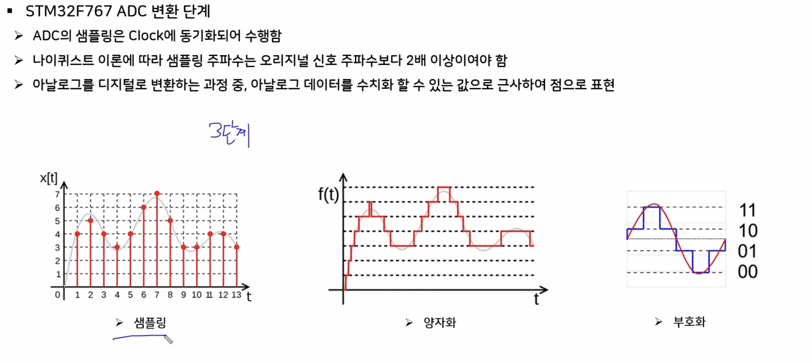
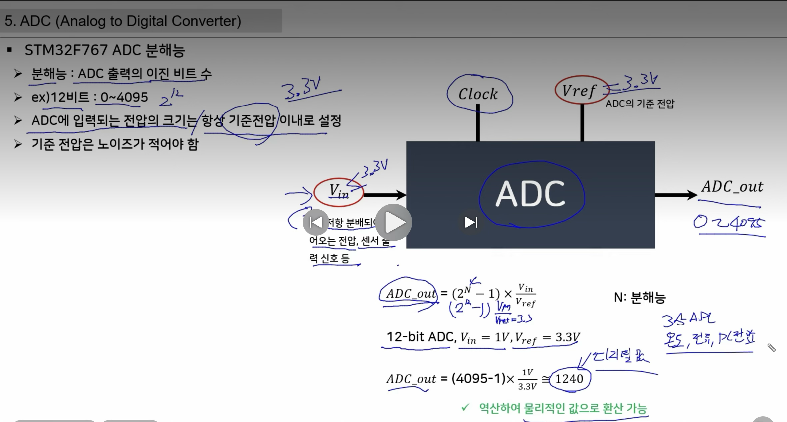
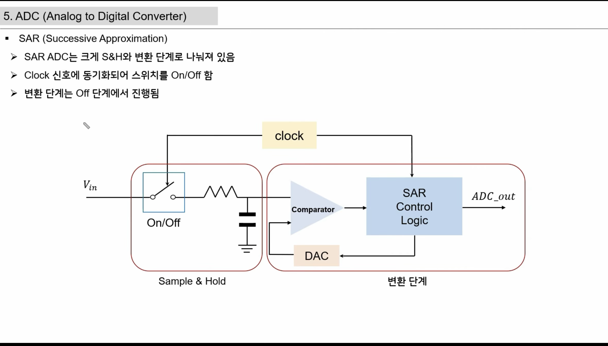
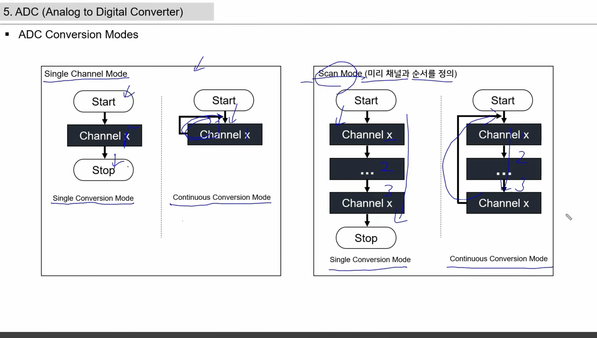

# STM32 ADC의 동작과 설정

NUCLEO-F411RE · ADC1

## 1. ADC를 사용하는 이유

ADC(Analog-to-Digital Converter)는 연속적으로 변하는 아날로그 전압을 MCU에서 처리할 수 있는 디지털 코드로 변환한다. 온도 센서처럼 물리량을 전압으로 출력하는 회로는 ADC로 전압을 읽은 뒤 센서의 전달 특성에 따라 원래 물리량으로 환산한다.

ADC에 연결하기 전에 입력 전압이 ADC의 기준 전압 범위(`VREF-`~`VREF+`)와 핀의 전기적 조건을 만족하는지 확인한다. 입력 범위를 초과하는 신호는 원래 회로의 전압과 안전 조건에 맞는 신호 조정 회로가 필요하다. 본문의 `3.3 V`는 환산 예에 사용한 기준 전압 범위다.

## 2. 샘플링·양자화·부호화

| 단계 | 동작 |
| --- | --- |
| 샘플링 | 연속 신호에서 특정 시점의 입력 전압을 취한다. 시간축을 이산화한다. |
| 양자화 | 취한 전압을 유한한 단계 중 하나로 나타낸다. 전압축을 이산화한다. |
| 부호화 | 선택된 단계를 이진 코드로 표현한다. |

일정한 간격으로 샘플링하여 주파수 성분을 보존하려면 샘플링 주파수가 입력 신호의 최고 주파수보다 두 배를 초과해야 한다. 채널별로 설정하는 ADC 샘플링 시간은 각 변환에서 입력 전압을 취하는 시간이다.



## 3. 분해능과 오차

STM32F411 ADC1은 12·10·8·6비트 분해능을 지원한다. 12비트 설정에서는 `2^12 = 4096`개의 코드를 사용하며 출력 범위는 `0~4095`다.

```text
이상적인 1 LSB = (VREF+ - VREF-) / 4096
기준 전압 범위가 3.3 V이면 1 LSB ≈ 0.806 mV
VREF- = 0 V, 입력 = 1.0 V이면 예상 결과 ≈ 1.0 / 3.3 × 4095 ≈ 1241
```

아래 강의 그림은 STM32F767을 예로 든다. 12비트 최대 코드가 `4095`이므로 본문의 전압 환산 근사식에서는 최대 코드에 1을 더 빼지 않는다.



| 오차 | 의미 |
| --- | --- |
| 양자화 오차 | 연속적인 전압을 유한한 단계로 나타내며 생긴다. 같은 기준 전압 범위에서는 비트 수가 높을수록 이상적인 스텝이 작다. |
| 오프셋 오차 | 변환 결과가 일정한 양만큼 치우친다. 오프셋을 측정한 뒤 더하거나 빼서 보정할 수 있다. |
| 이득 오차 | 입력과 결과 사이의 기울기가 달라진다. 기준 전압을 이용해 기울기를 측정한 뒤 보정 계수를 적용할 수 있다. |

실제 변환 정확도는 분해능 외에도 기준 전압의 안정성, 입력 노이즈, 회로 오차의 영향을 받는다.

## 4. SAR ADC와 샘플링 시간

1. **샘플 앤드 홀드**에서 스위치가 닫히는 동안 내부 샘플링 커패시터를 입력 전압으로 충전한다. 스위치가 열리면 변환에 사용할 전압을 유지한다.
2. **축차 비교(SAR)**에서 내부 DAC와 비교기로 전압을 비교하며 최상위 비트부터 차례로 결과를 결정한다.



STM32F411의 `ADC_SMPR1`과 `ADC_SMPR2`에서 채널별 샘플링 시간을 ADCCLK 사이클 단위로 설정한다. 12비트 변환 시간은 **샘플링 시간 + 12 ADC 클록 사이클**이다. 입력 소스의 임피던스가 높으면 커패시터가 목표 전압까지 충전되는 데 더 오래 걸리므로, 알려진 전압을 입력해 결과를 비교하면서 샘플링 시간을 정한다.

## 5. 변환 모드와 채널 그룹

| 설정 | 동작 |
| --- | --- |
| 단일 변환 | 트리거 한 번에 채널을 한 번 변환한다. 스캔을 사용하면 지정한 시퀀스를 한 번 변환한다. |
| 연속 변환 | 한 번 시작한 뒤 다음 트리거를 기다리지 않고 채널 또는 시퀀스의 변환을 반복한다. |
| 스캔 | 여러 채널과 변환 순서를 미리 설정한다. 연속 설정에 따라 시퀀스를 한 번 실행하거나 반복한다. |



- **Regular** 그룹은 일반 변환용으로 최대 16개 순서를 구성한다. `ADC_SQRx`에 순서를 지정하고 `ADC_DR`에서 변환 결과를 읽는다.
- **Injected** 그룹은 별도의 트리거로 우선 처리할 수 있으며 최대 4개 순서를 구성한다. `ADC_JSQR`에 순서를 지정하고 `ADC_JDR1`~`ADC_JDR4`에서 결과를 읽는다.

트리거 방식의 Injected 변환은 진행 중인 Regular 변환을 중단하고 먼저 실행된다. 완료 후 중단된 Regular 변환부터 재개한다. 반대로 Injected 변환 중 들어온 Regular 요청은 Injected 시퀀스가 끝난 뒤 처리된다.

## 6. STM32 설정과 HAL 흐름

외부 채널을 사용할 때는 데이터시트에서 ADC 입력을 지원하는 핀을 확인하고 GPIO를 아날로그 모드로 설정한다. CubeMX에서 ADC1의 분해능, 채널, 샘플링 시간, 변환 트리거를 지정한다. Regular 채널 하나를 소프트웨어로 시작해 폴링하는 경우, `HAL_ADC_Start()` → `HAL_ADC_PollForConversion()` → `HAL_ADC_GetValue()` 순서로 변환을 요청하고 완료된 결과를 읽는다.

현재 문서는 개념과 설정 흐름을 정리한 단계다. 실제 보드에서의 ADC 측정값은 실습 후 기록한다.

## 참고 자료

- ADC1의 변환 모드, 채널 시퀀스, 샘플링 시간 레지스터. [RM0383 — STM32F411 레퍼런스 매뉴얼](https://www.st.com/resource/en/reference_manual/dm00119316.pdf)
- ADC 입력 핀과 전기적 특성. [DS10314 — STM32F411 데이터시트](https://www.st.com/resource/en/datasheet/stm32f411re.pdf)
- 본문의 그림은 기존 강의 학습 자료다. [이미지 출처 기록](../../assets/README.md)
