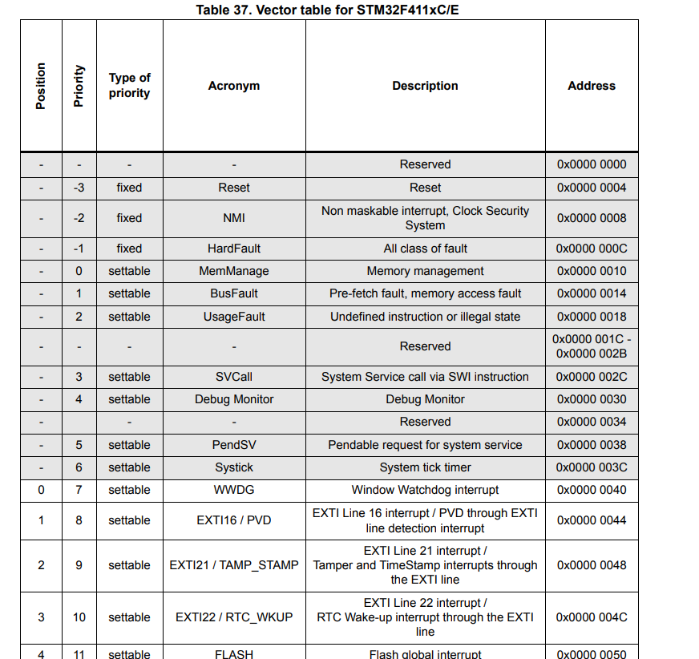
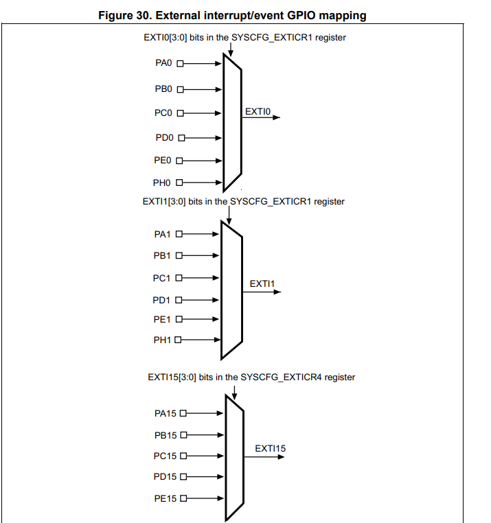
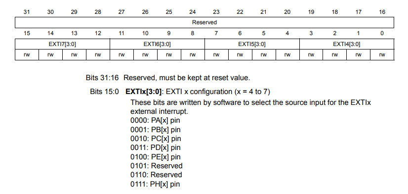

# GPIO 외부 인터럽트 학습 정리

2026-11-18 · NUCLEO-F411RE / EXTI·NVIC

## 1. 폴링과 인터럽트

| 방식 | 동작 | 특징 |
| --- | --- | --- |
| 폴링(Polling) | 프로그램이 입력이나 상태를 반복해서 읽음 | 단순하지만 검사 주기와 다른 작업의 지연에 영향을 받음 |
| 인터럽트(Interrupt) | 이벤트가 발생하면 요청을 받아 처리 함수 실행 | 메인 작업과 이벤트 처리를 분리할 수 있음 |

폴링은 반드시 요청이 올 때까지 멈춰 있는 방식은 아니다. 반복문에서 다른 일을 하면서 주기적으로 검사할 수도 있다.

인터럽트가 발생해도 언제나 즉시 현재 작업을 중단하는 것은 아니다. 인터럽트 허용 상태, 마스킹, 실행 중인 예외와 우선순위 등에 따라 처리 시점이 결정된다. 처리가 끝나면 중단했던 흐름으로 복귀한다.

## 2. NVIC와 벡터 테이블

### NVIC의 역할

NVIC(Nested Vectored Interrupt Controller)는 Cortex-M 코어의 인터럽트 제어기다. 인터럽트의 허용 여부와 우선순위를 관리하고, 처리할 요청을 코어에 전달한다.

ISR(Interrupt Service Routine)은 인터럽트 처리 함수다. STM32 프로젝트에서는 `EXTI4_IRQHandler()` 같은 이름으로 작성한다.

### 벡터 테이블의 역할

벡터 테이블은 예외와 인터럽트에 대응하는 처리 함수의 주소를 담는다. **주소가 실행 우선순위 순서로 정렬되는 것은 아니다.** 각 예외·IRQ에 정해진 위치가 있고 우선순위 설정은 별도로 관리한다. 첫 항목은 초기 스택 포인터 값이다.



표의 기호는 해당 표의 열과 범례를 함께 읽는다. 모든 항목의 우선순위가 고정된 것은 아니며 Reset·NMI·HardFault 등 고정 우선순위 예외와 설정 가능한 예외·IRQ를 구분한다. 일반적으로 설정 가능한 우선순위는 숫자가 작을수록 높다.

강의 그림에 등장하는 IRQ가 현재 MCU에도 있는지는 [STM32F411 CMSIS 헤더의 IRQn_Type](../../examples/gpio-led/Drivers/CMSIS/Device/ST/STM32F4xx/Include/stm32f411xe.h)에서 확인한다. 예를 들어 CAN1_TX라는 이름을 다른 MCU 그림에서 봤다고 해서 F411에서 사용할 수 있는 것은 아니다.

## 3. EXTI·SYSCFG·NVIC의 연결

**EXTI는 STM32의 주변장치이고, NVIC는 Cortex-M 코어의 인터럽트 제어기다.**

```text
GPIO 입력 변화
    ↓
SYSCFG: 어느 포트를 EXTI 입력으로 연결할지 선택
    ↓
EXTI: 상승/하강 에지 감지, Pending 설정, 마스크 확인
    ↓
NVIC: IRQ 허용 상태와 우선순위에 따라 처리
    ↓
CPU: 벡터 테이블의 IRQ 핸들러 실행
```

EXTI는 외부 GPIO뿐 아니라 일부 내부 신호도 처리한다. GPIO 외부 인터럽트는 EXTI0~EXTI15를 사용한다.



### GPIO 번호와 EXTI 라인

- PA4, PB4, PC4, PD4는 모두 EXTI4의 입력 후보이며, SYSCFG_EXTICR에서 사용할 포트 하나를 선택한다.
- 따라서 같은 EXTI4에 PA4와 PD4를 동시에 독립 입력으로 연결할 수는 없다.
- EXTI0~EXTI4는 각각 별도의 IRQ를 사용한다.
- EXTI5~EXTI9는 `EXTI9_5_IRQn`, EXTI10~EXTI15는 `EXTI15_10_IRQn`을 공유한다.
- 공유 IRQ에서는 어느 라인의 Pending 비트가 설정됐는지 확인해야 한다.

EXTI 주소로 출력을 하는 것이 아니라, EXTI를 통해 **입력 이벤트를 감지한 뒤 처리 함수에서 GPIO 출력을 제어**하는 것이다.

## 4. EXTI 설정에 사용하는 레지스터

| 설정 | 역할 |
| --- | --- |
| GPIO MODER | 사용할 핀을 입력 모드로 설정 |
| RCC의 GPIO / SYSCFG 클록 Enable | GPIO 설정과 SYSCFG 라우팅을 위한 클록 공급 |
| SYSCFG_EXTICR | EXTI 라인에 연결할 GPIO 포트 선택 |
| EXTI_IMR | 인터럽트 마스크. 해당 비트 1이면 요청 허용 |
| EXTI_EMR | 이벤트 마스크. 인터럽트와 이벤트는 구분 |
| EXTI_RTSR | 상승 에지 감지 설정 |
| EXTI_FTSR | 하강 에지 감지 설정 |
| EXTI_PR | 발생한 요청의 Pending 확인·해제 |
| NVIC 설정 | 해당 IRQ의 우선순위 설정과 실행 허용 |



상승 에지는 LOW → HIGH, 하강 에지는 HIGH → LOW다. 버튼을 누를 때 어느 에지가 발생하는지는 배선과 풀업·풀다운에 따라 달라진다.

**PR은 해당 비트에 1을 쓰면 지워지는 W1C(Write 1 to Clear) 방식이다.** `EXTI->PR = (1UL << 4);`는 EXTI4만 지운다. 모든 Pending을 지운다는 뜻이 아니다. `|=`는 읽어온 다른 Pending 비트까지 지울 수 있으므로 사용하지 않는다.

## 5. 강의 예제의 PD4 입력과 EXTI4

아래는 기존 PD3 LED·PD4 스위치 메모를 정리한 **레지스터 학습용 코드 조각**이다. 현재 F411RE 보드에서 PD3·PD4를 사용할 수 있다는 뜻이 아니며, 현재 배선에 그대로 적용하지 않는다.

```c
// GPIO와 SYSCFG 설정을 위한 클록 활성화
RCC->AHB1ENR |= RCC_AHB1ENR_GPIODEN;
(void)RCC->AHB1ENR;
RCC->APB2ENR |= RCC_APB2ENR_SYSCFGEN;
(void)RCC->APB2ENR;

// PD3: 출력, Push-Pull, 중간 속도
GPIOD->MODER = (GPIOD->MODER & ~(3UL << 6)) | (1UL << 6);
GPIOD->OTYPER &= ~(1UL << 3);
GPIOD->OSPEEDR = (GPIOD->OSPEEDR & ~(3UL << 6)) | (1UL << 6);
GPIOD->BSRR = (1UL << 3); // HIGH. LED의 켜짐 여부는 배선에 따라 달라진다.

// PD4: 입력 모드. 풀업/풀다운은 실제 회로에 맞게 별도로 설정
GPIOD->MODER &= ~(3UL << 8);

// EXTI4 소스: Port D (포트 선택 값 3)
SYSCFG->EXTICR[1] =
    (SYSCFG->EXTICR[1] & ~0xFUL) | 0x3UL;

// 초기화 중 요청을 마스킹하고 하강 에지만 선택
EXTI->IMR &= ~(1UL << 4);
EXTI->RTSR &= ~(1UL << 4);
EXTI->FTSR |= (1UL << 4);
EXTI->PR = (1UL << 4); // EXTI4의 기존 Pending만 해제

NVIC_SetPriority(EXTI4_IRQn, 5U); // 예시 우선순위
EXTI->IMR |= (1UL << 4);
NVIC_EnableIRQ(EXTI4_IRQn);
```

### 왜 EXTICR[1]인가?

EXTICR는 레지스터 하나에 4개 라인을 배치하고, 라인마다 4비트로 포트를 고른다.

```text
EXTICR[0] → EXTI0~3
EXTICR[1] → EXTI4~7
EXTICR[2] → EXTI8~11
EXTICR[3] → EXTI12~15

EXTI4의 배열 인덱스 = 4 / 4 = 1
필드 시작 비트 = (4 % 4) × 4 = 0
Port D 선택 값 = 3 = 0011 (2진수)
```

배열 인덱스는 0부터 시작하므로 `EXTICR[1]`은 매뉴얼의 SYSCFG_EXTICR2에 해당한다.

### IRQ 핸들러 구현

위 코드는 입력 라우팅과 요청 허용까지다. 실제 동작을 하려면 벡터 테이블과 이름이 일치하는 핸들러를 구현해야 한다.

```c
// PD4 학습 예제. HAL 처리 경로와 중복해서 사용하지 않는다.
void EXTI4_IRQHandler(void)
{
    if ((EXTI->PR & (1UL << 4)) != 0U)
    {
        EXTI->PR = (1UL << 4);
        // 필요한 처리 수행 또는 메인 루프가 확인할 플래그 설정
    }
}
```

ISR는 짧게 유지하고 긴 지연이나 무거운 작업은 메인 루프로 넘긴다. 기계식 버튼은 한 번 눌러도 여러 에지가 발생할 수 있으므로 디바운싱도 고려한다.

## 6. 내장 B1 버튼을 EXTI에 연결하는 예

GPIO LED 프로젝트에서 내장 버튼 **B1은 PC13**, 내장 LED **LD2는 PA5**를 사용한다. PC13을 인터럽트에 연결하면 다음 경로를 따른다.

```text
PC13 → EXTI13 → EXTI15_10_IRQn → EXTI15_10_IRQHandler()
```

HAL을 사용하는 경우의 호출 흐름은 다음과 같다.

```text
EXTI15_10_IRQHandler()
    → HAL_GPIO_EXTI_IRQHandler(B1_Pin)
    → HAL_GPIO_EXTI_Callback(GPIO_Pin)
    → 버튼에 따른 처리
```

프로젝트의 HAL 구현은 IRQ 처리 함수에서 Pending을 확인·해제한 뒤 콜백을 호출한다. CubeMX가 만든 IRQ 핸들러와 사용자 콜백의 역할을 구분한다.

GPIO LED 프로젝트는 B1을 `GPIO_MODE_IT_FALLING`으로 초기화한다. 위 HAL 경로를 완성하려면 `EXTI15_10_IRQn`을 NVIC에서 활성화하고 프로젝트의 IRQ 핸들러를 연결해야 한다. 보드에서 B1을 누를 때의 입력 레벨과 에지를 확인한 뒤 LD2 제어에 사용할 수 있다.

## 7. 레지스터 기반 EXTI 실습

`examples/F411_EXTI_Practice/`에서는 외부 스위치 PB0·PB1의 하강 에지를 각각 EXTI0·EXTI1로 연결하고 PC0~PC3 LED를 제어한다. 프로젝트의 코드는 GPIO, SYSCFG, EXTI를 직접 설정하고 CMSIS 함수로 NVIC를 구성한다.

배선, ISR 구현 및 보드 확인 항목은 [스위치 인터럽트 실습](LED_switch_interrupt.md)에 정리했다.

## 참고 자료

- SYSCFG 라우팅, EXTI와 GPIO 레지스터. [RM0383 — STM32F411 레퍼런스 매뉴얼](https://www.st.com/resource/en/reference_manual/dm00119316.pdf)
- IRQ 번호와 레지스터 정의. [STM32F411 CMSIS 헤더](../../examples/gpio-led/Drivers/CMSIS/Device/ST/STM32F4xx/Include/stm32f411xe.h)
- EXTI IRQ 처리와 콜백. [HAL GPIO 구현](../../examples/gpio-led/Drivers/STM32F4xx_HAL_Driver/Src/stm32f4xx_hal_gpio.c)
- GPIO LED 프로젝트의 핸들러 목록. [stm32f4xx_it.c](../../examples/gpio-led/Core/Src/stm32f4xx_it.c)

그림은 기존 학습 이미지를 연결했다. 원본 출처와 대상 MCU·문서 버전은 확인 후 추가한다.
