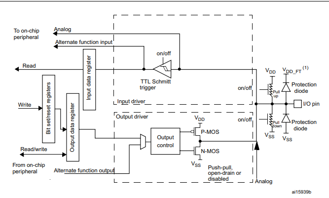
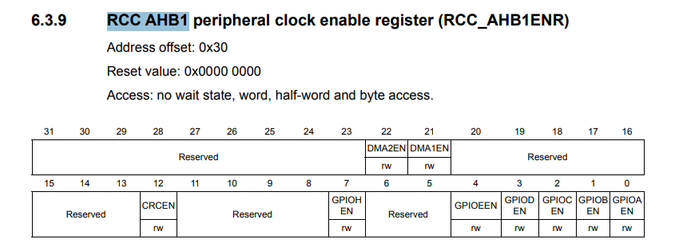
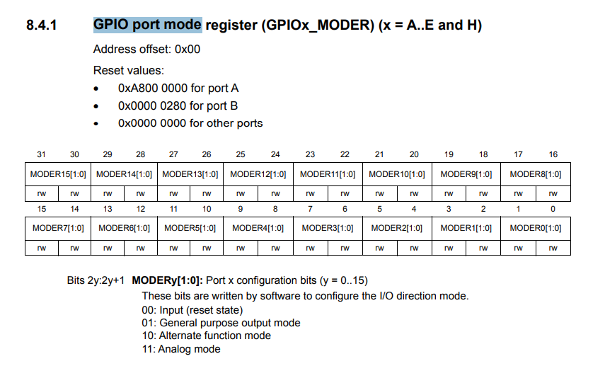
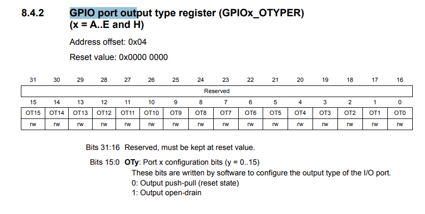
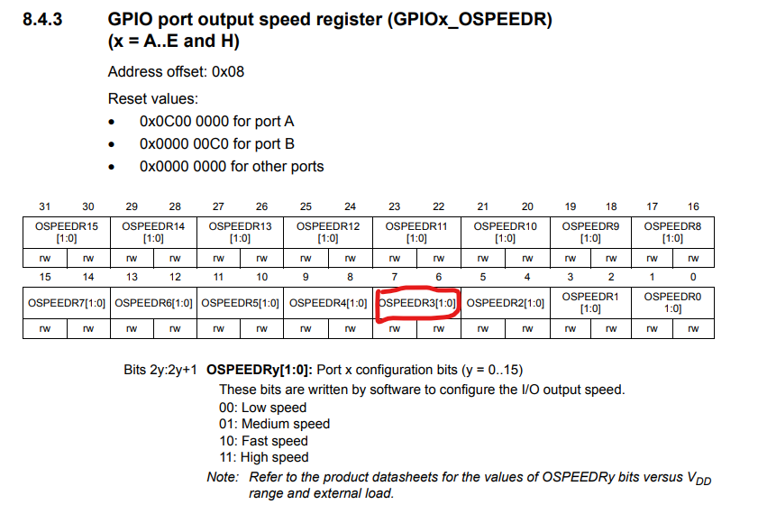
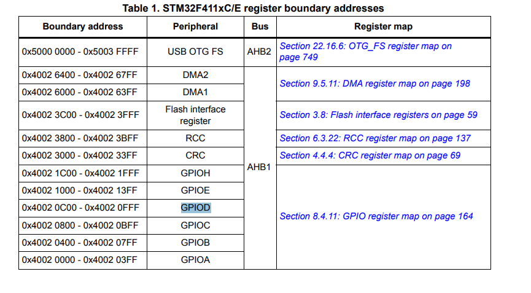
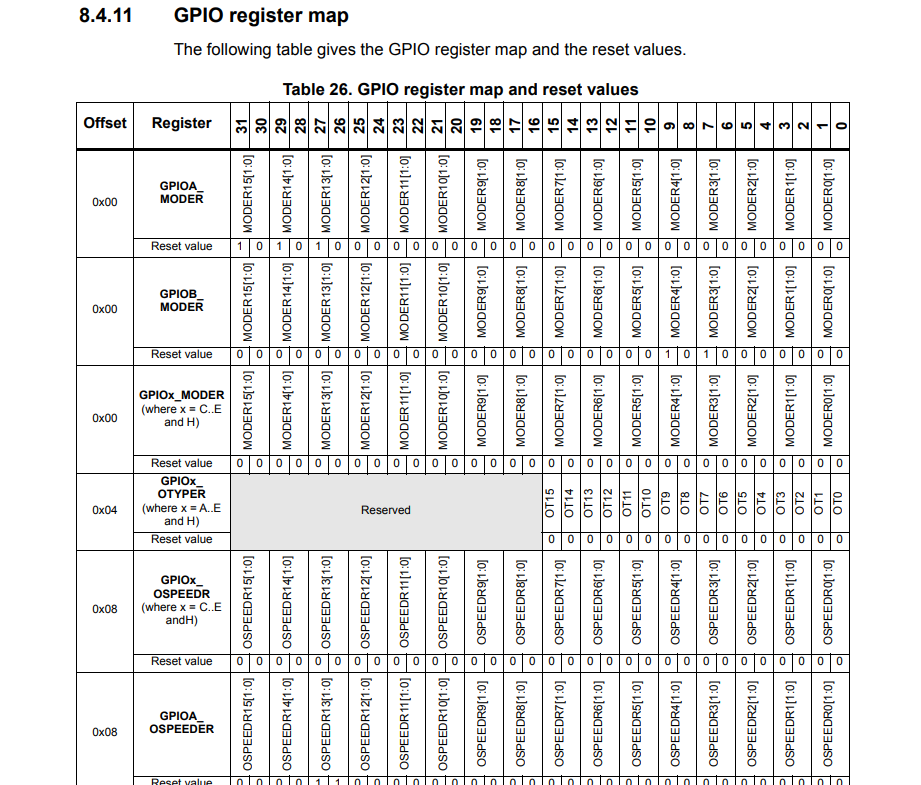

# GPIO LED 실습 요약

2026-11-09 · NUCLEO-F411RE

## 핀 구성

| 용도 | 핀 | 코드 이름 |
| --- | --- | --- |
| LED (LD2) | PA5 | `LD2_Pin` |
| 버튼 (B1) | PC13 | `B1_Pin` |

## 초기화 순서

```c
HAL_Init();              // HAL 초기화, 기본 시간 기준 설정
SystemClock_Config();    // 시스템 클록 설정
MX_GPIO_Init();          // GPIO 클록과 핀 모드 설정
MX_USART2_UART_Init();   // UART 통신 설정
```

## 1. 내장 LD2 점멸

보드에서 확인한 초기 예제다. `while (1)` 안에서 반복한다. 0.5초 켜지고 0.5초 꺼지므로 한 주기는 약 1초다.

```c
HAL_GPIO_WritePin(LD2_GPIO_Port, LD2_Pin, GPIO_PIN_SET);
HAL_Delay(500);
HAL_GPIO_WritePin(LD2_GPIO_Port, LD2_Pin, GPIO_PIN_RESET);
HAL_Delay(500);
```

## 2. 버튼 입력에 따른 LED 제어

점멸 코드 대신 `while (1)`의 `USER CODE BEGIN 3` 영역에 작성한다.

```c
if (HAL_GPIO_ReadPin(B1_GPIO_Port, B1_Pin) == GPIO_PIN_RESET)
{
    HAL_GPIO_WritePin(LD2_GPIO_Port, LD2_Pin, GPIO_PIN_SET);
}
else
{
    HAL_GPIO_WritePin(LD2_GPIO_Port, LD2_Pin, GPIO_PIN_RESET);
}
```

PC13 입력이 LOW이면 LED를 켜고, HIGH이면 끈다. 반복해서 입력을 읽는 **폴링 방식**이다.

## 핵심 함수

| 함수 | 역할 |
| --- | --- |
| `HAL_GPIO_WritePin(포트, 핀, 상태)` | 출력 HIGH / LOW 설정 |
| `HAL_GPIO_ReadPin(포트, 핀)` | 입력 HIGH / LOW 읽기 |
| `HAL_Delay(ms)` | 지정한 시간만큼 대기 |

`GPIO_PIN_SET` = HIGH · `GPIO_PIN_RESET` = LOW

## 코드 생성과 빌드

**CubeMX Generate Code → CubeIDE Build Project → Run / Debug**

- 자동 생성: 핀·클록 초기화 코드. `while`문 동작은 직접 작성한다.
- `B1_PIN` 오류: 정확한 이름은 **`B1_Pin`**이다. C는 대소문자를 구분한다.
- `.elf not found`: 빌드 성공 후 `Debug/test_led.elf`가 생성되는지 확인한다.

당시 핀 이름 오타를 수정했다. 현재 반복문의 빌드 점검 결과는 [5절](#5-현재-결과와-확인할-항목)에 정리했다.

---

## 3. LED 8개 동시 제어 · 2026-11-10

PC0~PC7에 연결한 LED 8개를 동시에 1초 켜고 1초 끄는 실습이다.

### 연결 및 설정

- 준비물: LED 8개, 1 kΩ 저항 8개, 브레드보드, 점퍼선
- 각 LED 배선: `GPIO(PC0~PC7) → 저항 → LED(+) → LED(-) → GND`
- CubeMX: PC0~PC7을 `GPIO_Output`, Push-Pull, No Pull로 설정
- 핀 라벨: PC0~PC7에 각각 `LED1`~`LED8` 지정
- 보드 커넥터 이름과 GPIO 이름은 다를 수 있으므로 핀맵으로 위치 확인

### 반복 코드

`while (1)`의 `USER CODE BEGIN 3` 영역에 작성한다.

```c
// LED 8개 ON
HAL_GPIO_WritePin(GPIOC,
    LED1_Pin | LED2_Pin | LED3_Pin | LED4_Pin |
    LED5_Pin | LED6_Pin | LED7_Pin | LED8_Pin,
    GPIO_PIN_SET);
HAL_Delay(1000);

// LED 8개 OFF
HAL_GPIO_WritePin(GPIOC,
    LED1_Pin | LED2_Pin | LED3_Pin | LED4_Pin |
    LED5_Pin | LED6_Pin | LED7_Pin | LED8_Pin,
    GPIO_PIN_RESET);
HAL_Delay(1000);
```

### 문제와 핵심

- **문제:** OFF 이후 딜레이가 없어 즉시 다시 켜졌다.
- **해결:** `GPIO_PIN_RESET` 이후에도 `HAL_Delay(1000)`을 추가했다.
- `|`는 핀 마스크를 합쳐 **같은 포트의 여러 핀을 한 번에 제어**한다.
- 이 배선에서는 `SET`이면 켜지고 `RESET`이면 꺼진다. 딜레이 동안 해당 출력 상태가 유지되며, 전체 점멸 주기는 약 2초다.

## 4. GPIO 레지스터 학습 · 2026-11-17

HAL 함수로 LED를 제어하는 것에서 더 나아가, **어느 주소의 어떤 비트를 바꾸면 핀이 동작하는지**를 학습했다.

### 레지스터의 역할

제어·상태·데이터는 레지스터를 역할로 구분한 것이다. GPIO 설정이 세 단계라는 뜻은 아니다.

| 구분 | 역할 | 예시 |
| --- | --- | --- |
| 제어·설정 | 주변장치의 동작 방식 설정 | MODER, OTYPER, OSPEEDR |
| 상태 | 동작 상태나 이벤트 확인 | 통신 주변장치의 상태 플래그 |
| 데이터 | 입력을 읽거나 출력을 설정 | IDR, ODR |

이번에 다루는 GPIO 레지스터는 32비트다. 매뉴얼에서 각 비트의 의미와 Reset value를 확인한다. Reset value는 리셋 직후 값이며 모든 레지스터가 0인 것은 아니다.



### 클록과 출력 설정

**PD3는 레지스터 해석용 예제다.** LED 8개 실습은 PC0~PC7을 사용한다. 실제 배선에 사용할 핀은 MCU 패키지와 보드 핀맵에서 확인한다.

| 순서 | 설정 | PD3 학습 예제 |
| --- | --- | --- |
| 1 | RCC에서 포트 클록 활성화 | AHB1ENR의 GPIODEN(bit 3)을 1로 설정 |
| 2 | MODER에서 핀 모드 선택 | 필드 [7:6]을 01, 일반 출력으로 설정 |
| 3 | OTYPER에서 출력 타입 선택 | bit 3을 0, Push-Pull로 설정 |
| 4 | OSPEEDR에서 출력 전환 속도 선택 | 필드 [7:6]을 01, 중간 속도로 설정 |

클록 활성화는 **포트 D 전체에 클록을 공급하도록 허용하는 작업**이다. 클록 주파수를 설정하는 작업과 구분한다.

MODER의 필드 값은 00=입력, 01=출력, 10=대체 기능, 11=아날로그다. 실제 지원하는 대체 기능과 ADC 채널은 핀마다 다르다.

OSPEEDR는 LED의 점멸 간격을 정하지 않는다. 출력 전환 특성에 영향을 주며, 불필요하게 빠른 전환은 EMI와 신호 품질에 영향을 줄 수 있으므로 목적에 맞게 선택한다.









### 왜 01이 0x00000040이 되는가?

01은 **핀 3에 해당하는 2비트 필드 안에 넣을 값**이다. MODER는 핀마다 2비트를 사용하므로 핀 3의 필드는 bit 6부터 시작한다.

```text
필드 시작 위치 = 핀 번호 × 2 = 3 × 2 = 6
01 << 6 = 0000 0000 0100 0000 (2진수)
        = 0x00000040 (16진수)
        = 64 (10진수)

bit 7 = 0, bit 6 = 1 → [7:6] = 01
```

다만 `|= (1UL << 6)`만 쓰면 기존 bit 7이 지워지지 않는다. 두 비트를 먼저 지우고 값을 넣어야 기존 값과 관계없이 정확히 01이 된다.

```c
GPIOD->MODER = (GPIOD->MODER & ~(3UL << 6)) | (1UL << 6);
```

3은 이진수 11이다. `~(3UL << 6)`은 bit 7과 bit 6만 0인 마스크여서 AND 연산으로 해당 필드를 지우고 다른 핀의 설정은 유지한다.

### ODR로 출력 바꾸기

ODR는 핀마다 1비트를 사용하므로 핀 3은 bit 3이다. MODER의 필드 위치와 구분한다.

```c
// PD3 레지스터 학습 예제: 현재 프로젝트 실행 코드가 아님
RCC->AHB1ENR |= (1UL << 3);
(void)RCC->AHB1ENR; // 클록 활성화 후 레지스터 읽기

GPIOD->MODER = (GPIOD->MODER & ~(3UL << 6)) | (1UL << 6);
GPIOD->OTYPER &= ~(1UL << 3); // Push-Pull
GPIOD->OSPEEDR = (GPIOD->OSPEEDR & ~(3UL << 6)) | (1UL << 6);

GPIOD->ODR &= ~(1UL << 3); // LOW
GPIOD->ODR |=  (1UL << 3); // HIGH
```

LOW가 LED ON인지 OFF인지는 배선에 따라 달라진다. 앞의 `GPIO → 저항 → LED → GND` 배선에서는 HIGH일 때 켜진다. 지연 없이 두 출력을 반복하면 눈으로 점멸을 구분하기 어렵다.

ODR의 `|=`, `&=`는 읽기 → 수정 → 쓰기 연산이다. 다른 실행 흐름에서도 출력을 변경하면 간섭에 주의해야 한다. 현재 HAL의 `HAL_GPIO_WritePin()`은 BSRR를 사용해 지정한 비트를 SET/RESET한다.

### 메모리 맵과 오프셋

**메모리 맵에서 주변장치 시작 주소를 찾고, 레지스터 맵에서 레지스터 오프셋을 찾는다.** 오프셋은 시작 주소에서 떨어진 바이트 수다.





```text
레지스터 주소 = 주변장치 시작 주소 + 레지스터 오프셋

GPIOD MODER = 0x40020C00 + 0x00 = 0x40020C00
GPIOD ODR   = 0x40020C00 + 0x14 = 0x40020C14
RCC AHB1ENR = 0x40023800 + 0x30 = 0x40023830
```

| GPIO 레지스터 | 오프셋 | 역할 |
| --- | --- | --- |
| MODER | 0x00 | 핀 모드 |
| OTYPER | 0x04 | 출력 타입 |
| OSPEEDR | 0x08 | 출력 속도 |
| PUPDR | 0x0C | 내부 Pull-up / Pull-down |
| IDR | 0x10 | 입력 데이터 |
| ODR | 0x14 | 출력 데이터 |
| BSRR | 0x18 | 지정 핀의 출력 SET / RESET |

### 주소를 포인터로 접근하기

```c
// 독립적인 주소 접근 학습 예제
// STM32 헤더의 기존 정의와 중복되지 않도록 접두사를 사용한다.
#include <stdint.h>

#define STUDY_GPIOD_BASE        0x40020C00UL
#define STUDY_RCC_BASE          0x40023800UL
#define STUDY_GPIO_MODER_OFFSET 0x00UL
#define STUDY_GPIO_ODR_OFFSET   0x14UL
#define STUDY_RCC_AHB1ENR_OFFSET 0x30UL

#define STUDY_GPIOD_MODER \
    (*(volatile uint32_t *)(STUDY_GPIOD_BASE + STUDY_GPIO_MODER_OFFSET))
#define STUDY_GPIOD_ODR \
    (*(volatile uint32_t *)(STUDY_GPIOD_BASE + STUDY_GPIO_ODR_OFFSET))
#define STUDY_RCC_AHB1ENR \
    (*(volatile uint32_t *)(STUDY_RCC_BASE + STUDY_RCC_AHB1ENR_OFFSET))
```

- `UL`: 정수 상수를 unsigned long 타입으로 지정한다.
- `uint32_t *`: 계산한 주소를 32비트 값에 접근하는 포인터로 해석한다.
- `volatile`: 하드웨어 레지스터에 필요한 읽기·쓰기가 수행되도록 한다. 연산 전체를 원자적으로 만드는 것은 아니다.
- 바깥쪽 `*`: 포인터가 가리키는 레지스터를 읽거나 쓸 수 있도록 역참조한다.

`STUDY_GPIOD_ODR |= (1UL << 3);`은 계산한 ODR 주소의 값을 읽고 bit 3을 1로 만든 뒤 다시 쓰는 동작이다.

### 구조체로 연결하기

레지스터 주소를 하나씩 작성하면 오프셋을 틀리기 쉽다. 프로젝트의 CMSIS 헤더는 이미 `GPIO_TypeDef` 구조체와 GPIO 포인터를 제공한다. 구조체 멤버가 레지스터 오프셋에 맞게 배치되어 있으므로 `GPIOC->MODER`처럼 접근할 수 있다.

```text
메모리 맵 → 시작 주소
레지스터 맵 → 오프셋
시작 주소 + 오프셋 → volatile 포인터로 접근
CMSIS 구조체 → GPIOC->MODER처럼 접근
HAL 함수 → 설정과 제어를 함수로 수행
```

이번에 이해한 핵심은 **HAL 아래에서도 특정 메모리 주소의 비트를 읽고 쓴다**는 것이다. 주소와 비트 위치를 이해하면 HAL 함수가 하드웨어를 어떻게 제어하는지도 연결해서 볼 수 있다.

## 5. 현재 결과와 확인할 항목

- 현재 반복문의 목표는 PC0~PC7을 HIGH 1초 / LOW 1초로 제어하는 것이다. `HAL_GPIO_WritePin()` 두 곳에서 `LED5_Pin`~`LED8_Pin`과 핀 마스크 뒤 쉼표가 빠졌다. ARM GCC 구문 검사에서 `too few arguments to function 'HAL_GPIO_WritePin'` 오류가 발생했다. 위 [반복 코드](#반복-코드)에 핀 8개의 마스크와 출력 상태를 넘기는 예를 남겼다.
- 버튼 예제는 LOW를 눌림으로 해석한다. 실제 눌림 레벨은 회로와 입력값으로 확인한다. 현재 B1 초기화 모드는 `GPIO_MODE_IT_FALLING`이지만 위 예제 자체는 폴링 코드다.
- 초기 내장 LD2 점멸은 보드에서 정상 동작을 확인했다. 외부 LED 8개와 버튼의 검증 결과는 각각 확인 후 기록한다.
- PD3 코드는 레지스터 학습 예제로 구분하며 현재 보드에서 실행한 결과로 기록하지 않는다.
- 이미지 이름과 상대 경로를 실제 파일에 맞췄다. 외부 그림의 출처와 문서 버전은 확인 후 추가한다.

## 관련 코드

- GPIO 초기화와 반복 동작. [main.c](../../examples/gpio-led/Core/Src/main.c)
- 핀 이름과 포트 정의. [main.h](../../examples/gpio-led/Core/Inc/main.h)
- 레지스터 구조체와 비트 정의. [CMSIS 헤더](../../examples/gpio-led/Drivers/CMSIS/Device/ST/STM32F4xx/Include/stm32f411xe.h)
- `HAL_GPIO_WritePin()`의 BSRR 접근. [HAL GPIO 구현](../../examples/gpio-led/Drivers/STM32F4xx_HAL_Driver/Src/stm32f4xx_hal_gpio.c)
