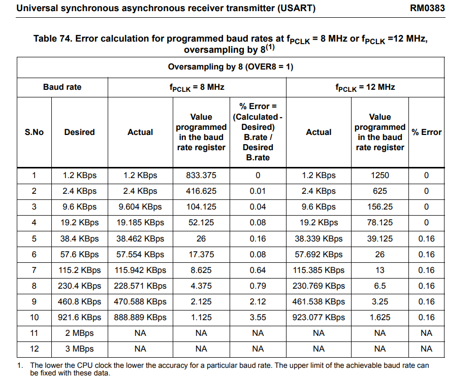

# STM32 UART·USART 통신과 인터럽트 에코

NUCLEO-F411RE · USART2

## 1. 통신 방식

| 기준 | 방식 | 특징 |
| --- | --- | --- |
| 비트 전송 | 직렬 | 한 경로에서 한 비트씩 전송한다. UART·SPI·I²C·USB·CAN이 대표적이다. |
| 비트 전송 | 병렬 | 여러 데이터선으로 여러 비트를 동시에 전송한다. 짧은 거리에서 대역폭을 확보하기 좋으며, MCU 내부 버스나 구형 프린터 포트가 예다. |
| 송수신 방향 | 반이중 | 양방향 전송이 가능하며 한 번에 한 방향만 사용한다. 무전기가 예다. |
| 송수신 방향 | 전이중 | 송신과 수신을 동시에 할 수 있다. TX와 RX가 분리된 UART에서 사용한다. |
| 시간 기준 | 동기 | SPI의 SCK, I²C의 SCL처럼 클록 신호를 기준으로 데이터를 읽는다. SPI는 CPOL·CPHA에 따라 유휴 클록 레벨과 샘플링 에지가 달라진다. |
| 시간 기준 | 비동기 | UART처럼 수신기가 시작 비트를 감지한 뒤 합의한 비트 속도로 데이터를 읽는다. |

직렬 방식은 병렬보다 데이터선이 적다. 실제 전송 거리와 노이즈 내성은 전기적 표준, 배선, 비트 속도에 따라 달라진다.

UART는 Universal Asynchronous Receiver/Transmitter의 약자다. USART는 Synchronous와 Asynchronous를 모두 지원하며, 이 실습에서는 USART2를 비동기 UART 모드로 설정한다.

## 2. UART 프레임

송신기와 수신기는 **보드레이트(baud rate), 데이터 비트 수, 패리티, 정지 비트 수**를 같은 값으로 설정한다. 이 실습의 `8-N-1`은 데이터 8비트, 패리티 없음, 정지 비트 1개를 뜻한다.

1. 유휴 상태에서 TX는 HIGH다. HIGH에서 LOW로 바뀌면 시작 비트가 전송된다.
2. 데이터 비트는 최하위 비트(LSB)부터 전송한다. 패리티를 사용하면 데이터 뒤에 패리티 비트가 온다.
3. 정지 비트 구간에는 TX가 HIGH다.

ASCII `A`는 `0x41`이고, 상위 비트부터 적으면 `0100 0001`이다. `8-N-1` 프레임의 실제 전송 순서는 다음과 같다.

```text
시간 →  [시작] [ D0 D1 D2 D3 D4 D5 D6 D7 ] [정지]
           0      1  0  0  0  0  0  1  0      1
```

보드레이트는 초당 심볼 수다. 이 UART에서는 심볼당 1비트이므로 초당 비트 수(bps)와 값이 같다. `8-N-1`은 데이터 1바이트를 보내는 데 시작·정지 비트까지 총 10비트를 사용한다.

## 3. USART2 클록과 BRR

STM32F411에서 USART2는 APB1에 연결되어 있으므로 `PCLK1`으로 보드레이트를 계산한다. [클록 정리](../clock/clock.md)에 나온 `42 MHz`는 GPIO LED 프로젝트의 설정이다. UART 실습의 `PCLK1`은 HSI `16 MHz`에 AHB와 APB1 분주를 모두 `/1`로 적용한 값이다.

| 설정 | 의미 |
| --- | --- |
| `USART_CR1.OVER8 = 0` | 16배 오버샘플링. `BRR[3:0]` 전체에 소수부를 기록한다. |
| `USART_CR1.OVER8 = 1` | 8배 오버샘플링. 소수부는 `BRR[2:0]`에 기록하고 `BRR[3]`은 0으로 둔다. |
| `USART_BRR` | 주변장치 클록을 원하는 보드레이트에 맞추는 분주 값을 저장한다. |

16배 오버샘플링에서는 `PCLK1 / baud rate`을 가장 가까운 정수로 반올림하면 BRR 인코딩 값을 구할 수 있다.

```text
USART_TEST: 16,000,000 / 115,200 ≈ 138.89 → BRR = 139 (0x008B)
강의 계산 예: 54,000,000 / 9,600 = 5,625 → BRR = 5,625 (0x15F9)
```

아래 그림은 RM0383의 8배 오버샘플링에서 `PCLK`가 `8 MHz` 또는 `12 MHz`일 때의 오차 예다.



## 4. USART_TEST 실습

| 항목 | 소스에서 확인한 설정 |
| --- | --- |
| USART 모드 | USART2 비동기 송수신 |
| 핀 | PA2 TX · PA3 RX, AF7 |
| 프레임 | 115200 bps · 8-N-1 · 흐름 제어 없음 |
| 오버샘플링 | 16배 |
| 동작 | 인터럽트로 1바이트 수신 후 같은 바이트 송신을 요청하는 에코 |

`MX_USART2_UART_Init()`에서 프레임과 속도를 설정하고 `HAL_UART_Init()`을 호출한다. `HAL_UART_MspInit()`은 GPIO 대체 기능과 USART2 클록을 켜고 NVIC에서 USART2 IRQ를 활성화한다. HAL의 `UART_SetConfig()`는 `HAL_RCC_GetPCLK1Freq()`와 보드레이트로 BRR을 계산한다.

```text
초기화 → HAL_UART_Receive_IT()로 1바이트 수신 예약
수신 완료 → USART2_IRQHandler() → HAL_UART_IRQHandler()
          → HAL_UART_RxCpltCallback() → 다음 수신 예약 및 에코 송신 요청
```

현재 콜백의 핵심은 다음과 같다.

```c
void HAL_UART_RxCpltCallback(UART_HandleTypeDef *huart)
{
    if (huart->Instance == USART2)
    {
        HAL_UART_Receive_IT(&huart2, &rxData, 1);
        HAL_UART_Transmit_IT(&huart2, &rxData, 1);
    }
}
```

`HAL_UART_Transmit_IT()`는 송신을 예약한다. 현재 코드는 송수신에 `rxData` 하나를 공유하고 반환값을 확인하지 않으므로, 이 실습은 터미널에서 한 글자씩 보내고 같은 글자가 돌아오는지 확인한다. 기본 VCP 배선의 NUCLEO-F411RE에서는 ST-LINK USB로 연결하고 시리얼 터미널을 `115200, 8-N-1`로 설정한다. 빌드 및 보드에서의 에코 결과는 확인 후 기록한다.

## 관련 코드와 참고 자료

- 초기화와 수신 콜백. [USART_TEST의 main.c](../../examples/USART_TEST/Core/Src/main.c)
- 송수신 핀, USART2 클록 및 NVIC 설정. [MSP 초기화](../../examples/USART_TEST/Core/Src/stm32f4xx_hal_msp.c)
- IRQ 핸들러와 BRR 계산. [IRQ 핸들러](../../examples/USART_TEST/Core/Src/stm32f4xx_it.c) · [HAL UART 구현](../../examples/USART_TEST/Drivers/STM32F4xx_HAL_Driver/Src/stm32f4xx_hal_uart.c)
- USART 프레임과 보드레이트 분주. [RM0383 — STM32F411 레퍼런스 매뉴얼](https://www.st.com/resource/en/reference_manual/dm00119316.pdf)
- ST-LINK Virtual COM Port와 보드 배선. [UM1724 — Nucleo-64 보드 매뉴얼](https://www.st.com/resource/en/user_manual/dm00105823.pdf)
