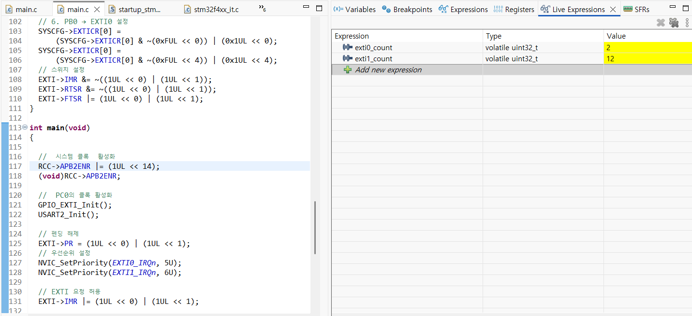
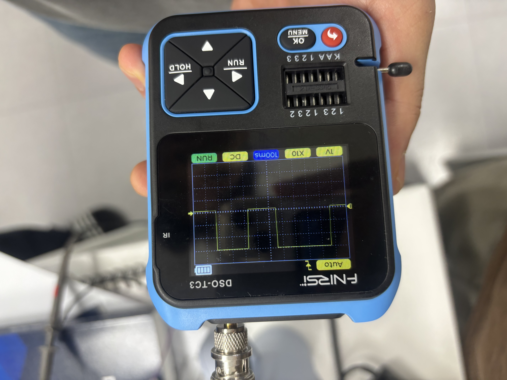
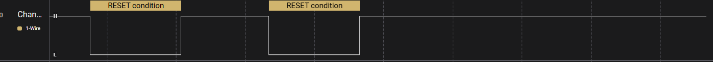
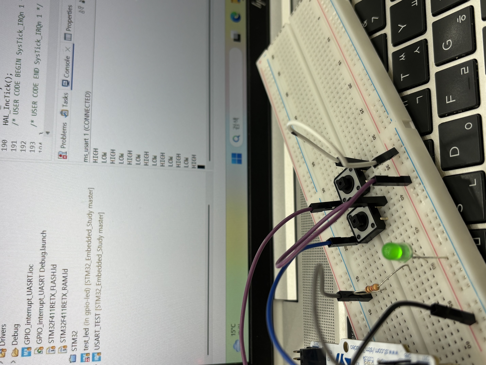

# USART2·GPIO 인터럽트 실습 회고

2026-11-26 · NUCLEO-F411RE

## 실습 목표

USART2를 레지스터로 초기화한 뒤, 스위치 인터럽트로 LED를 제어하고 그 상태를 UART 터미널로 보내는 것이 목표였다.

| 입력 | LED 출력 (`PC0`) | UART 메시지 |
| --- | --- | --- |
| `PB0` 스위치 누름 | 켜짐 (`HIGH`) | `HIGH` |
| `PB1` 스위치 누름 | 꺼짐 (`LOW`) | `LOW` |

`PB0`와 `PB1`은 내부 풀업 입력이다. 평소에는 `HIGH`이고 버튼을 누르면 `LOW`가 되므로, 눌리는 순간의 **하강 에지**를 인터럽트로 받도록 했다.

```c
EXTI->RTSR &= ~((1UL << 0) | (1UL << 1));
EXTI->FTSR |= (1UL << 0) | (1UL << 1);
```

`RTSR`는 상승 에지(`LOW → HIGH`), `FTSR`는 하강 에지(`HIGH → LOW`)를 선택하는 레지스터다.

## UART 출력이 중복된 이유를 찾기

LED는 스위치에 맞춰 켜지고 꺼졌지만, UART 터미널에는 같은 문구가 여러 번 찍혔다. 버튼을 한 번 눌러도 기계식 접점이 안정되기 전까지 `HIGH`와 `LOW`가 짧게 반복되는 **채터링**이 원인일 수 있다고 생각했다. 이때 하강 에지가 여러 번 생기면 EXTI도 여러 번 실행될 수 있다. LED는 같은 켜기 또는 끄기 명령을 반복해도 상태가 그대로여서 눈으로는 중복을 알아차리기 어려웠다.

실제로 인터럽트가 여러 번 들어오는지 확인하려고 `exti0_count`, `exti1_count`를 만들고 각 핸들러에 진입할 때마다 해당 카운터를 올렸다. STM32CubeIDE에서 `F11`로 디버깅을 시작한 뒤 `Window → Show View → Live Expressions`에서 카운터를 봤다. 버튼을 한 번 눌렀을 때 값이 여러 번 증가하는 것을 확인했다.



의찬 씨의 도움을 받아 소형 오실로스코프로도 확인했다. 화면의 시간축은 `100 ms`였고, 캡처에서는 짧은 접점 변화를 구분하기 어려웠다. 시간축이 넓어 변화가 보이지 않았을 가능성이 있다. 로직 분석기로도 측정했지만, 이번 캡처에서는 채터링 구간을 직접 확인하지 못했다.





## SysTick으로 디바운싱 구현

접점 때문에 짧은 시간에 들어오는 중복 신호를 걸러내는 것을 **디바운싱**이라고 한다. 이번에는 버튼별로 마지막으로 받아들인 인터럽트의 시간을 저장하고, 같은 버튼에서 너무 빨리 들어오는 다음 인터럽트를 무시했다.

SysTick은 Cortex-M4 코어의 24비트 다운 카운터다. 코어 클록이 16 MHz이면 1 ms에 16,000클록이므로 `LOAD`에 `16000 - 1`을 쓰고, SysTick 인터럽트마다 `tick_ms`를 1씩 올렸다.

| 레지스터 | 역할 |
| --- | --- |
| `CTRL` | 클록 소스, 인터럽트, 타이머 동작 설정 |
| `LOAD` | 카운터의 재장전 값 설정 |
| `VAL` | 현재 카운터 값 확인 또는 초기화 |
| `CALIB` | 타이머 보정 관련 정보 |

```c
void SysTick_Init(void)
{
    SysTick->CTRL = 0;
    SysTick->LOAD = 16000 - 1;
    SysTick->VAL = 0;
    SysTick->CTRL = 0x7UL;  // CLKSOURCE, TICKINT, ENABLE
}
```

각 EXTI 핸들러는 `PR` 플래그를 지우고 전체 인터럽트 횟수를 올린다. 첫 입력은 바로 받아들이고, 이후에는 마지막으로 받아들인 입력과의 간격을 검사한다. 아래는 `PB0`의 검사 부분이다.

```c
uint32_t now = tick_ms;
if (exti0_initialized && (now - last_exti0) < DEBOUNCE_MS)
{
    return;
}

exti0_initialized = 1;
last_exti0 = now;
exti0_valid_count++;
```

검사를 통과하면 LED를 바꾸고 `rx`에 보낼 문자열의 주소를 넣는다. `main()`은 그 주소를 가져와 `TXE`가 켜질 때마다 `USART2->DR`에 한 글자씩 써서 `\0`까지 전송한다. [실습 코드](../../examples/GPIO_interrupt_UASRT/Core/Src/main.c) · [SysTick 핸들러](../../examples/GPIO_interrupt_UASRT/Core/Src/stm32f4xx_it.c)

## 결과와 다음 실험

디바운싱을 적용한 뒤 실습에서 UART 메시지의 중복 출력을 줄일 수 있었다. 현재 기준은 버튼마다 `500 ms`라서, 같은 버튼을 그 안에 다시 누르면 의도한 입력도 걸러진다.



다음에는 오실로스코프의 시간축을 좁혀 버튼을 누르거나 떼는 순간을 다시 관찰하고 싶다. 접점이 안정되기까지 걸리는 시간을 직접 재서 디바운싱 기준을 얼마나 줄일 수 있는지 확인해 보고, 접지 상태를 점검하거나 하드웨어 디바운싱을 적용했을 때의 차이도 비교해 보고 싶다.
전원 버튼 같은 다른 접점 입력에도 이 방법을 적용할 수 있는지, 온도 센서처럼 측정값이 흔들리는 경우에는 어떤 방식으로 값을 안정화하는지도 더 알아보고 싶다.

## 느낀 점

오실로스코프나 로직 분석기로 채터링이 일어나는 순간을 직접 보고 싶었는데, 이번에는 보지 못해 아쉬웠다. 그래도 실제 스위치 접점의 움직임이 내가 작성한 프로그램 흐름에 영향을 준다는 점이 새로웠다. 이전에 서버 쪽을 개발할 때는 이런 물리적인 입력 문제를 겪을 일이 거의 없었다.

코드를 작성할 때는 AI의 도움을 받았다. 다시 작성해 보니 흐름은 이해했지만, 질문을 받았을 때 바로 설명하기 어려운 부분이 있었다. 다음에는 EXTI가 언제 들어오고 SysTick으로 어떤 시간을 비교하는지, 코드 없이도 내 말로 설명할 수 있을 만큼 익히고 싶다. 앞으로도 이런 문제를 직접 측정하고 원인을 좁혀가는 경험을 더 해보고 싶다.
