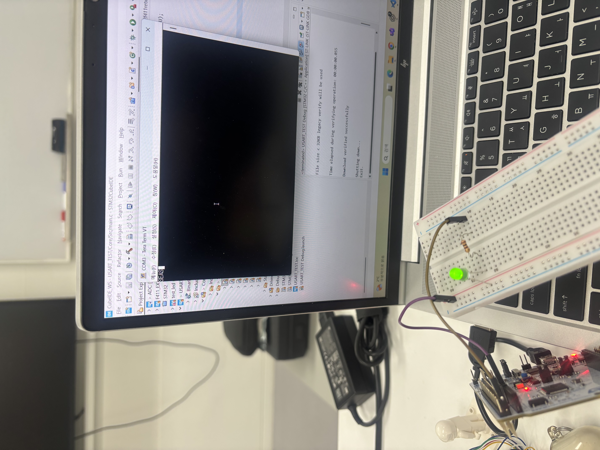

# UART / USART 통신

## 1. UART 통신이란?

**UART (Universal Asynchronous Receiver/Transmitter, 범용 비동기 송수신기)**는 병렬 데이터를 직렬 데이터로 변환하여 전송하고, 수신 측에서는 직렬 데이터를 다시 병렬 데이터로 변환하는 하드웨어이다.

즉, **병렬 데이터를 비동기 직렬 방식으로 송수신하는 하드웨어**이다.

### 기본 개념

- **병렬 데이터(Parallel)**: 여러 개의 데이터 선을 이용해 여러 비트를 동시에 전송한다.
  - 예: `H` → `01001000` (8비트)
- **직렬 데이터(Serial)**: 하나의 데이터 선을 통해 비트를 순서대로 하나씩 전송한다.
- **비동기(Asynchronous)**: 별도의 클록 선 없이 송신 측과 수신 측이 약속된 통신 속도를 기준으로 데이터를 주고받는다.

### UART와 USART의 차이

- UART: 비동기 통신을 지원한다.
- USART: 비동기 통신뿐 아니라 동기 통신도 지원한다.

USART의 S는 Synchronous를 의미한다.

---

## 2. 동기 통신과 비동기 통신

### 2-1. 동기 통신 (Synchronous Communication)

- 송신 측과 수신 측이 클록(CLK)을 기준으로 데이터를 주고받는다.
- 수신 측은 클록의 특정 Edge 시점에 데이터를 읽는다.
- 별도의 클록 신호선이 필요한 방식이 대표적이다.
- 클록을 공유하므로 고속 데이터 전송에 유리하다.

**클록 복원 기술 (CDR: Clock and Data Recovery)**

고속 직렬 통신에서는 별도의 클록 선 없이 데이터 신호의 변화를 이용해 클록을 복원하기도 한다.

- PLL 등을 활용해 데이터 신호의 Edge를 추적하고 클록을 복원한다.
- `0000`처럼 신호 변화가 없는 구간에서는 클록 복원이 어려워질 수 있다.
- 이를 해결하기 위해 8b/10b 인코딩이나 스크램블링 등의 기술을 사용한다.

### 2-2. 비동기 통신 (Asynchronous Communication)

- 별도의 CLK 라인이 없다.
- 송신 측과 수신 측이 약속된 Baud Rate를 사용한다.
- Start Bit과 Stop Bit을 이용해 데이터 프레임의 시작과 끝을 구분한다.
- 별도의 클록 동기화 선이 필요하지 않아 구현이 간단하다.

**UART 데이터 프레임**

- Start Bit: 데이터 전송 시작을 알림 (LOW)
- Data Bit: 실제 데이터
- Parity Bit: 선택적으로 오류 검출에 사용
- Stop Bit: 데이터 전송 종료를 알림 (HIGH)

### UART는 어디에 사용하는가?

1. **MCU ↔ PC**
   - STM32에서 센서값, 디버깅 메시지, 오류 정보를 PC로 전송한다.

2. **MCU ↔ 센서 및 통신 모듈**
   - GPS/GNSS 수신기, 레이저 거리 측정 센서, 블루투스 모듈 등과 데이터를 주고받는다.

3. **산업용 장비 간 통신**
   - 모터 드라이버, 계측 장비, 산업용 제어기 등의 설정값과 상태 정보를 교환한다.

---

## 3. 비트레이트(Bit Rate)와 보레이트(Baud Rate)

UART 통신에서 반드시 알아야 할 개념이다.

- **Baud Rate**
  - 초당 신호 심볼(Symbol)이 전달되는 횟수.
  - 물리적인 신호의 변화 속도를 나타내는 단위이다.

- **Bit Rate**
  - 초당 전송되는 비트 수.
  - 실제 논리 데이터의 전송 속도를 나타낸다.

### 둘의 차이

STM32에서 사용하는 일반적인 UART는 HIGH와 LOW 두 가지 신호 상태를 사용한다.

따라서 하나의 심볼이 1비트를 표현하므로 다음 관계가 성립한다.

`Bit Rate = Baud Rate`

하지만 4-PAM처럼 4개의 전압 상태를 사용하는 경우에는 하나의 심볼로 2비트를 표현할 수 있다.

`Bit Rate = Baud Rate × 2`

즉, **심볼 하나가 표현하는 비트 수에 따라 Bit Rate와 Baud Rate가 달라진다.**

> 참고: Baud Rate의 단위는 Baud이며, Bit Rate의 단위는 bps이다.

### Baud Rate에 영향을 주는 요소

- **케이블 길이**
  - 길이가 길어질수록 신호 감쇠, 반사, 지연 등의 문제가 발생할 가능성이 높아진다.
  - 일반적으로 높은 통신 속도를 유지하기 어려워진다.

- **노이즈 환경**
  - 노이즈가 많을수록 수신 데이터의 오류 가능성이 높아진다.
  - 통신 속도, 배선, 신호 품질 등을 고려해야 한다.

- **클록 소스**
  - 클록의 정확도가 통신 속도의 정확도에 영향을 준다.
  - 크리스털은 일반적으로 내부 RC 오실레이터보다 높은 주파수 정확도를 제공한다.

---

## 4. UART는 CLK 없이 어떻게 데이터를 읽을까?

### Oversampling (오버샘플링)

오버샘플링은 하나의 비트 구간을 여러 번 샘플링하여 수신 데이터를 판별하는 방식이다.

일반적으로 STM32F411 USART는 16배 또는 8배 오버샘플링을 지원한다.

예를 들어 16배 오버샘플링이라면 하나의 비트 구간을 16개의 샘플링 지점으로 나누어 확인한다.

**왜 여러 번 샘플링할까?**

- 신호가 전환되는 순간에는 전압이 불안정할 수 있다.
- 비트의 중앙 부분을 샘플링하면 전환 구간의 영향을 줄일 수 있다.
- 여러 샘플을 이용해 다수결 방식으로 데이터를 판별할 수 있다.

### 중앙 3개 샘플링

16배 오버샘플링에서는 일반적으로 비트 중앙의 3개 샘플(8, 9, 10번)을 이용해 데이터를 판별한다.

- 3개가 모두 동일하면 해당 값을 판정한다.
- 서로 다른 값이 존재하면 다수결로 데이터를 판정한다.
- 이 과정에서 노이즈가 검출되면 NE(Noise Error) 플래그가 설정될 수 있다.

NE 인터럽트가 활성화되어 있다면 해당 오류를 처리하는 인터럽트가 발생할 수 있다.

### Oversampling 설정

STM32F411에서는 `CR1` 레지스터의 OVER8 비트로 설정한다.

```c
// USART2: 16배 오버샘플링
USART2->CR1 &= ~(1UL << 15);

// USART2: 8배 오버샘플링
USART2->CR1 |= (1UL << 15);
```

- OVER8 = 0 → 16배 오버샘플링
- OVER8 = 1 → 8배 오버샘플링


### 최대 통신 속도

16배 오버샘플링에서는 최대 Baud Rate가 USART에 공급되는 클록의 1/16로 제한된다.

8배 오버샘플링에서는 최대 Baud Rate가 클록의 1/8로 제한된다.

즉, 오버샘플링 배수가 커질수록 최대 통신 속도는 낮아진다.

---

## 5. RCC → PCLK → BRR → Baud Rate

UART 통신 속도를 이해하려면 클록과 BRR의 관계를 알아야 한다.

전체 흐름은 다음과 같다.

`RCC 클록 설정 → PCLK 공급 → BRR 분주 설정 → Baud Rate 결정`

### 5-1. PCLK

RCC에서 설정한 클록은 APB 버스를 통해 USART에 공급된다.

STM32F411에서 USART2는 APB1 버스의 PCLK1을 사용한다.

### 5-2. BRR

BRR(Baud Rate Register)은 USART에 공급되는 클록을 원하는 통신 속도에 맞게 분주하기 위한 레지스터이다.

즉, PCLK를 기반으로 원하는 Baud Rate를 만들어내는 역할을 한다.

### 5-3. BRR과 USARTDIV

USARTDIV는 BRR에 저장된 정수부와 소수부를 조합하여 해석한 분주값이다.

STM32F411에서는 Oversampling 설정에 따라 소수부의 해석 방식이 달라진다.

**16배 오버샘플링**

`USARTDIV = 정수부 + 소수부 / 16`

**8배 오버샘플링**

`USARTDIV = 정수부 + 소수부 / 8`

예를 들어 다음과 같은 상황을 살펴보자.

```c
BRR = 0x00000036;
```

2진수로 변환하면 다음과 같다.

`0011 0110`

- 정수부: 3
- 소수부: 6

**① Oversampling 16배**

- 정수부 = 3
- 소수부 = 6 / 16 = 0.375
- USARTDIV = 3.375

**② Oversampling 8배**

- 정수부 = 3
- 소수부 = 6 / 8 = 0.75
- USARTDIV = 3.75


### Baud Rate 계산

STM32F411의 Baud Rate 계산식은 다음과 같다.

- 16배 오버샘플링

`Baud Rate = PCLK / (16 × USARTDIV)`

- 8배 오버샘플링

`Baud Rate = PCLK / (8 × USARTDIV)`

결국 BRR에 저장된 분주값에 따라 실제 통신 속도가 결정된다.

> 주의: BRR은 원하는 Baud Rate를 기준으로 계산하여 설정하는 값이다. 실제 하드웨어에서는 BRR의 비트 필드와 OVER8 설정에 맞게 값을 인코딩해야 한다.

---

## 6. USART 내부 동작 구조

### 6-1. 송신 흐름 (TX)

1. CPU 또는 DMA가 TDR(Transmit Data Register)에 전송할 데이터를 기록한다.
2. 데이터가 TSR(Transmit Shift Register)로 이동한다.
3. TSR에서 Start Bit, Parity Bit, Stop Bit 등을 포함한 프레임을 구성한다.
4. 데이터를 한 비트씩 TX 핀으로 출력한다.

즉, **병렬 데이터를 직렬 데이터로 변환하는 과정**이다.

송신 제어는 Transmit Control이 담당한다.

- CR1의 TE: 송신 기능 활성화
- TXEIE: 송신 데이터 레지스터가 비었을 때 인터럽트 허용
- TCIE: 실제 전송 완료 시 인터럽트 허용

### 6-2. 수신 흐름 (RX)

1. RX 핀에서 Start Bit을 감지한다.
2. 오버샘플링을 이용해 수신 신호를 판별한다.
3. 수신된 직렬 데이터가 RSR(Receive Shift Register)에 저장된다.
4. 데이터 프레임이 완성되면 RDR(Receive Data Register)로 이동한다.
5. CPU 또는 DMA가 버스를 통해 데이터를 읽는다.

즉, **직렬 데이터를 병렬 데이터로 변환하는 과정**이다.

수신 제어는 Receive Control이 담당한다.

- CR1의 RE: 수신 기능 활성화
- RXNEIE: 수신 데이터 준비 시 인터럽트 허용
- IDLEIE: 수신 라인이 Idle 상태가 되었을 때 인터럽트 허용

### 6-3. Wakeup Unit

특정 데이터 패턴이나 조건을 감지하여 MCU가 저전력 상태에서 깨어날 수 있도록 지원하는 하드웨어 기능이다.


---

## 7. USART 레지스터 제어

HAL 함수를 사용하기 전에 USART 내부 레지스터의 역할을 이해한다.

### USART_SR : Status Register

현재 USART의 통신 상태를 확인하는 레지스터이다.

- TXE: 송신 데이터 레지스터가 비어 있어 새로운 데이터를 기록할 수 있는 상태.
- TC: 실제 송신 프레임 전송이 완료된 상태.
- RXNE: 수신 데이터가 준비되어 읽을 수 있는 상태.
- ORE: 수신 오버런 오류.
- NE: 노이즈 오류.

**송신 예시**

```c
while (!(USART2->SR & USART_SR_TXE))
{
    // TDR이 비워질 때까지 대기
}

USART2->DR = 'A';
```

**수신 예시**

```c
while (!(USART2->SR & USART_SR_RXNE))
{
    // 수신될 때까지 대기
}

uint8_t data = (uint8_t)USART2->DR;
```

### USART_DR : Data Register

- 실제 송수신 데이터를 저장하는 레지스터.
- 쓰기 시 TDR(송신), 읽기 시 RDR(수신)에 접근한다.
- 32bit 중 하위 9bit `[8:0]`를 사용한다.
- Parity 활성화 시 데이터 프레임의 최상위 비트를 Parity Bit로 사용한다.

```c
USART2->DR = data;          // TDR에 데이터 기록
data = USART2->DR;          // RDR에서 데이터 읽기
```

### USART_CR1 : Control Register 1

- USART의 기본 동작을 설정한다.
- UE: USART 활성화.
- TE: 송신 활성화.
- RE: 수신 활성화.
- M: 데이터 프레임 길이 설정.
- PCE / PS: Parity 설정.
- TXEIE / RXNEIE / TCIE: 인터럽트 설정.
- OVER8: 오버샘플링 설정.

### USART_CR2 : Control Register 2

- Stop Bit의 길이 설정.
- 동기식 통신의 클록 관련 설정.

### USART_CR3 : Control Register 3

- DMA 송수신 설정.
- 하드웨어 흐름 제어(RTS/CTS).
- Half-Duplex 통신 등 추가 기능 설정.

### USART_BRR : Baud Rate Register

- USART에 공급되는 클록을 기반으로 통신 속도를 설정한다.
- 정수부와 소수부로 나뉘어 USARTDIV를 표현한다.
- Oversampling 설정에 따라 소수부 해석이 달라진다.

---

## 8. STM32 실습

### 실습 목표

- USART 레지스터를 이용한 데이터 수신.
- 수신된 문자에 따라 LED 제어.
- 수신한 데이터를 PC로 다시 전송(Echo).

### 구현 코드

```c
static void MX_USART2_UART_Init(void);
UART_HandleTypeDef huart2;

int main(void)
{
    // GPIOC 클록 활성화
    RCC->AHB1ENR |= (1UL << 2);
    (void)RCC->AHB1ENR;

    // USART2 초기화는 HAL 사용
    MX_USART2_UART_Init();

    // PC0 출력 설정
    GPIOC->OTYPER &= ~(1UL << 0);
    GPIOC->OSPEEDR &= ~(3UL << 0);
    GPIOC->PUPDR &= ~(3UL << 0);

    GPIOC->BSRR = (1UL << 16);

    GPIOC->MODER =
        (GPIOC->MODER & ~(3UL << 0)) | (1UL << 0);

    while (1)
    {
        // 수신 데이터 확인
        if ((USART2->SR & USART_SR_RXNE) != 0U)
        {
            uint8_t rx = (uint8_t)USART2->DR;

            // S 입력 시 LED ON
            if (rx == 'S')
            {
                GPIOC->BSRR = 1UL << 0;
            }
            // E 입력 시 LED OFF
            else if (rx == 'E')
            {
                GPIOC->BSRR = 1UL << 16;
            }

            // 송신 준비 대기
            while ((USART2->SR & USART_SR_TXE) == 0U);

            // 수신한 문자 다시 전송
            USART2->DR = rx;
        }
    }
}
```

### 구현 시 확인 사항

- GPIOC 클록은 직접 활성화했다.
- USART2 초기화는 HAL 함수를 사용했다.
- USART2의 PA2(TX), PA3(RX)는 Alternate Function 설정이 필요하다.
- USART2의 APB1 클록은 HAL 초기화 과정에서 설정되도록 구성했다.
- 실제 송수신 데이터 처리는 SR과 DR 레지스터를 직접 사용했다.
- PC에서 `S`를 입력하면 LED ON, `E`를 입력하면 LED OFF.
- 수신한 문자를 다시 PC로 전송하는 Echo 기능 구현.

### 아쉬운 점 및 추가 학습

USART 초기화까지 레지스터로 구현하지 못했다.

특히 다음 과정이 아직 어렵다.

- GPIO Alternate Function 설정.
- USART2 주변장치 클록 활성화.
- BRR 계산 및 설정.
- CR1, CR2, CR3 초기화.
- USART 전체 활성화 순서.

추후에는 HAL 초기화 없이 레지스터만으로 USART 초기화부터 송수신까지 구현해 보는 것을 목표로 한다.

---



**최종 정리**

UART는 별도의 클록 선 없이 약속된 통신 속도를 기반으로 데이터를 직렬 전송하는 방식이다.

STM32에서는 RCC를 통해 USART에 클록을 공급하고, BRR로 통신 속도를 설정하며, SR과 DR을 이용해 데이터 송수신을 제어한다. CR1, CR2, CR3는 USART의 동작 방식과 추가 기능을 설정한다.